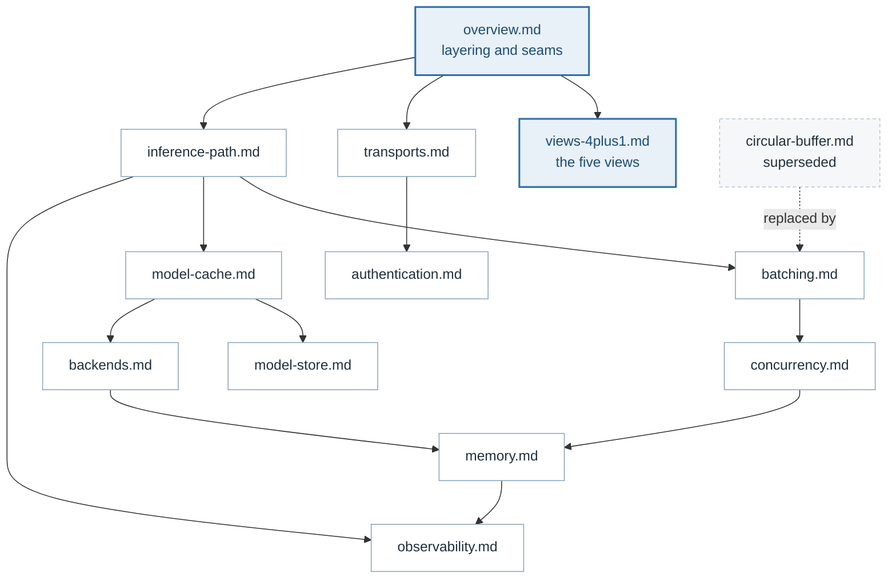

# GaleMind Inference Server Design

The design of GaleMind Server, one document per decision that has a shape
worth drawing. The [README](../../README.md) says how to run the server and the
[documentation site](../../website) explains how to use it; these pages say why
it is built the way it is.

Every diagram here is Mermaid in the Markdown itself, so it renders on GitHub
and changes in the same commit as the code it describes: flowcharts for how
the parts fit, sequence diagrams for what happens in what order, and a class
diagram per page for the traits and types that page is about. The five 4+1
views also exist as standalone sources under
[`website/diagrams/`](../../website/diagrams), which are rendered to SVG for
the documentation site.

Each page opens with the problem it was written to solve and how that problem
got solved, and ends with the files it describes.

## Read in this order

| Document | What it covers |
|---|---|
| [overview.md](overview.md) | The layering, the traits everything replaceable sits behind, and what happens between process start and the first served request. |
| [views-4plus1.md](views-4plus1.md) | Kruchten's four views of this server — logical, process, development, physical — and the two scenarios that tie them together. |
| [transports.md](transports.md) | Two ports, one service: the Predict Protocol v2 surface, and how one domain error becomes an HTTP status and a gRPC code. |
| [inference-path.md](inference-path.md) | One request from socket to answer, including every way it can end early. |
| [batching.md](batching.md) | The per-model dispatcher, the adaptive window, and why batch size follows Little's law. |
| [model-cache.md](model-cache.md) | The hot tier: bounded, time-to-live, single-flight, and why listing models must not load them. |
| [model-store.md](model-store.md) | The cold tier: a directory tree, RocksDB column families, and the startup ingest between them. |
| [backends.md](backends.md) | The `Backend` seam, the ONNX Runtime adapter, and the two memory decisions inside it. |
| [concurrency.md](concurrency.md) | Async workers, blocking threads, the per-session mutex, and which flag bounds which. |
| [memory.md](memory.md) | The high-water guard, its two-step reclaim, and how retention is told apart from a leak. |
| [authentication.md](authentication.md) | Authentication as a seam, the endpoints that stay open, and why the exemption list lives in the domain. |
| [observability.md](observability.md) | Triton-compatible metric names, the per-request span, and the resource sampler. |

## Superseded

| Document | Why it is kept |
|---|---|
| [circular-buffer.md](circular-buffer.md) | The first buffering design, replaced by the bounded queue in [batching.md](batching.md). Kept because the reason it was replaced is the reason the queue is bounded. |

## How the documents relate

## Keeping them true

A design document that disagrees with the code is worse than no document, so
these are written against named types and flags rather than against
intentions. When a seam moves, the document that names it moves in the same
commit. Each page ends with the files it describes, so the check is a `grep`
rather than a reading.
