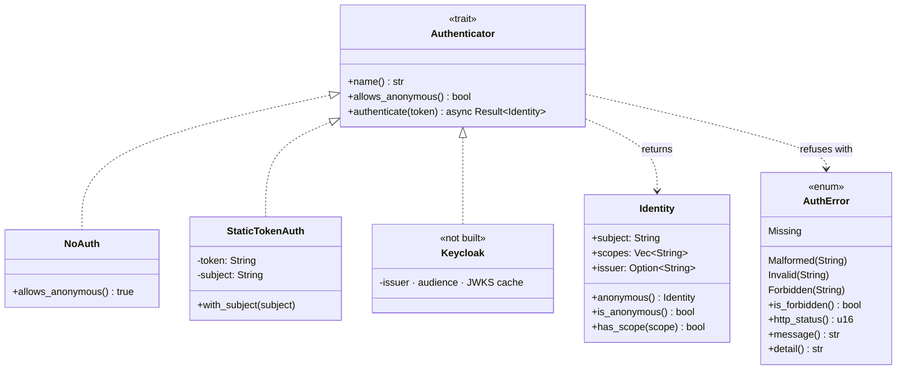
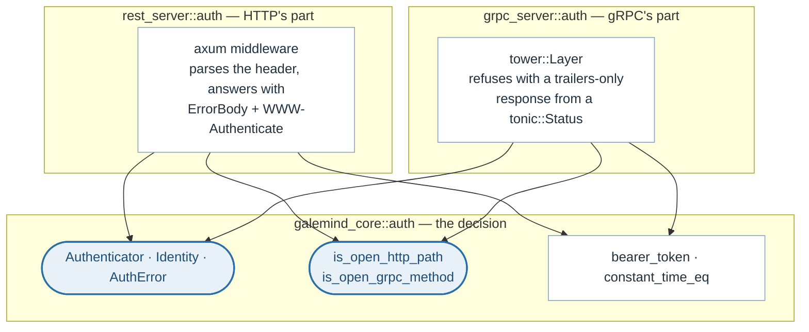

# Authentication

> **The problem.** The server needs somewhere for an identity check to go
> before any identity provider has been chosen, and the choice belongs to the
> deployment. Both ports then have to enforce the same decision, while
> orchestrator probes and metric scrapes keep working without credentials to
> send.
>
> **How it is solved.** `Authenticator` is a trait in the domain, with `NoAuth`
> as the default and a constant-time shared secret as a second implementation
> to keep the seam honest. The exemption lists live beside the trait rather
> than in either transport, so the two ports cannot drift into protecting
> different things.

Authentication here is a seam rather than a decision. The server needs
somewhere for an identity check to go before one is chosen, and the choice is
a deployment's: a server behind a service mesh wants none, a shared one wants
tokens from the organisation's identity provider.

So the server ships **open**. A shared secret is the one check that needs no
provider, so it is the one the binary can offer; anything issuing real
identities implements the trait and is wired in with a line of code.

## The types

`authenticate` takes `Option<&str>`, where `None` means the request carried no
`Authorization` header at all. An implementation may accept that — which is
how a mixed deployment serves anonymous reads and authenticated inference —
and `allows_anonymous` lets a transport refuse a credential-less request
without making the call.

`Identity` is put in the request's extensions by whichever transport checked
it. Nothing in the protocol's handlers reads it yet; it is there so that
per-model authorization or per-tenant metrics can be added without touching
the middleware again.

## Why the trait is in the domain

Both transports have to make the same decision about the same token, and an
identity provider is not an HTTP detail. What a transport adds is the part
that is genuinely its own: parsing a header, shaping a refusal, and routing.

The exemption lists live in the domain too, which is the load-bearing part: if
each port kept its own list, the two could drift into protecting different
things, and nobody would notice until one of them was the one exposed.

## What stays open, whatever is configured

| | HTTP | gRPC |
|---|---|---|
| Liveness | `/v2/health/live` | `ServerLive` |
| Readiness | `/v2/health/ready` | `ServerReady` |
| Model readiness | `/v2/models/{model}/ready` `/v2/models/{model}/versions/{version}/ready` | `ModelReady` |
| Metrics | `/metrics` | — |

A liveness or readiness probe is run by an orchestrator that has no token to
send, and a metrics scrape by Prometheus, which has no way to send one.
Requiring a token on these turns switching authentication on into a rolling
restart of a server that then reports itself unhealthy.

A model's own readiness counts as a probe. A deployment that preloads nothing
needs a probe that waits for one named model before traffic arrives, and that
probe has no more credentials than the server-wide one. What it can tell an
unauthenticated caller is whether a model it already knew the name of is
loaded — a boolean, from a name it had to supply — and not what models exist,
what they take or what they answer. Those are the catalogue and metadata
endpoints, which stay closed.

A deployment that considers even that too much keeps the port off the public
network; one that considers the counters sensitive turns the scrape off with
`--allow-metrics false`.

The readiness paths are matched on **shape**, not by prefix, so only the two
URLs the protocol defines are open. A model literally named `ready` cannot
widen the hole, because the segment count still has to match.

## Two statuses, not one

| `AuthError` | HTTP | gRPC | Means |
|---|---|---|---|
| `Missing` | 401 | `UNAUTHENTICATED` | No `Authorization` header at all |
| `Malformed` | 401 | `UNAUTHENTICATED` | Present, but not a bearer token |
| `Invalid` | 401 | `UNAUTHENTICATED` | A bearer token that did not check out |
| `Forbidden` | 403 | `PERMISSION_DENIED` | A valid token that does not permit this |

The split is by what the caller should do about it. Conflating them sends a
caller to re-authenticate over and over against a permission they will never
be granted.

A 401 carries a `WWW-Authenticate` challenge, as RFC 9110 requires: a 401
without one tells a client it was refused but not how to try again. A 403 is
not a challenge — the credential was understood and does not reach far enough,
so inviting a retry would be a loop.

What the caller is told is deliberately short of detail. Why a token failed to
verify is useful to an operator in the log and useful to an attacker in a
response body, so `message()` is generic and `detail()` goes to the log.

## Why the gRPC check is a layer, not an interceptor

tonic's own seam is `Interceptor`, which is a *synchronous*
`Request<()> -> Result<Request<()>, Status>`. That is enough for a shared
secret and not enough for anything that fetches: a real provider has to await
— Keycloak's JWKS is an HTTP call, a cached key still expires, an
introspection endpoint is a round trip. Doing that from a sync interceptor
means blocking a runtime thread per request, which is a way to deadlock a
server under load rather than a way to authenticate it.

So the check is a `tower::Layer` in front of the router, where the future is
ours and an await is just an await. It sits at the same place in the stack as
the axum middleware on the other port, reads the same `authorization` header
from the HTTP/2 request tonic is carrying the call on, and refuses with a
trailers-only response built from a `tonic::Status` — which is what a gRPC
client expects, rather than the bare HTTP status an HTTP-shaped rejection
would send.

## The shared secret

`--auth-token`, or better `GALEMIND_AUTH_TOKEN`: an argument is visible in the
process list to every user on the machine.

The comparison is constant-time. `==` on a slice returns as soon as a byte
differs, which over many attempts reveals a prefix; the length is not secret —
it leaks through the response either way — so differing lengths may return
early.

`StaticTokenAuth` is not an identity provider: every caller is the same
subject, and there is nothing to revoke but the secret itself. Its real value
beyond small deployments is that it is a *second* implementation of the trait,
which is what keeps the seam honest. A transport cannot quietly come to depend
on authentication always succeeding when something in the test suite refuses.

`NoAuth` ignores a token that is sent rather than trusting it. Reporting an
unverified token's subject as an identity would make an unauthenticated server
look like an authenticated one in the log.

## Adding a provider

Implement `Authenticator` and pass it to `rest_server::app_with_auth` and
`grpc_server::serve_with_auth`. Nothing else in the server changes.

Keycloak is the case the seam was shaped for. It would hold the realm's issuer
URL, the audience it accepts and a cache of the realm's JWKS;
`authenticate` would verify the token's signature against the cached key for
its `kid`, check `iss`, `aud` and `exp`, and return the `sub` with the realm
roles as scopes — refusing with `Invalid` on a bad signature or an expired
token, and refetching the JWKS when a `kid` is unknown. Because `authenticate`
is async, fetching an uncached key is an await rather than a blocking call on a
request thread. It needs a JWT library and a key cache, which is why it is not
here yet: this is the seam it plugs into, not a placeholder for it.

## Described by

`src/core/src/auth.rs`, `src/rest_server/src/auth.rs`,
`src/grpc_server/src/auth.rs`, `src/galemind/src/cli.rs` (`AuthArgs`).
