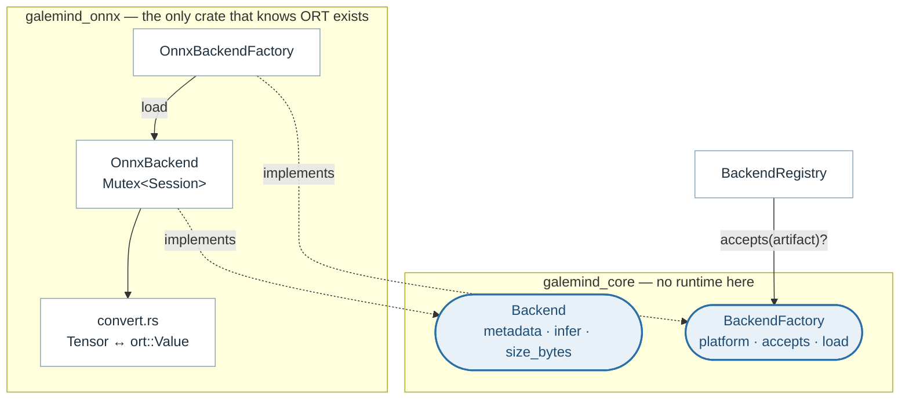
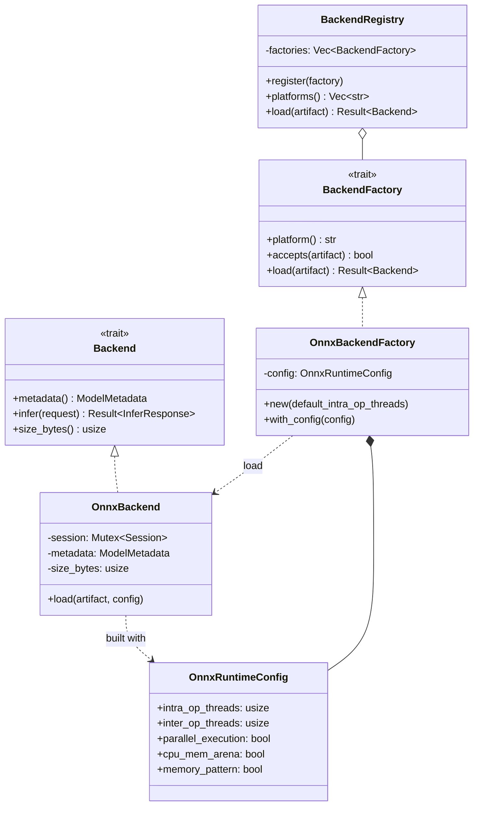
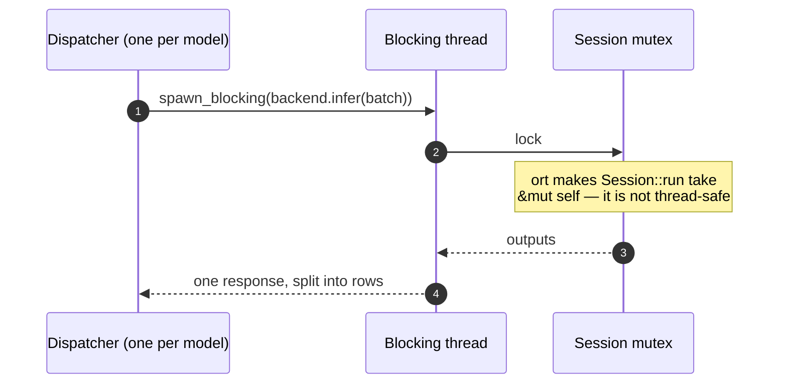

# Backends

> **The problem.** The server has to execute models through a third-party
> runtime whose API, threading model and allocator behaviour are its own. Left
> unchecked those spread: the runtime's types reach the transports, and its
> arena quietly decides the process's memory profile.
>
> **How it is solved.** A three-method `Backend` trait and a factory that
> claims a platform string, implemented in the one crate in the workspace that
> mentions `ort`. The session is built once per loaded version and reused, and
> the two options that would make memory grow without bound are off by default.

A backend is one loaded model, ready to execute. The trait is three methods
wide, which is the whole reason a runtime is replaceable here:

```rust
fn metadata(&self) -> &ModelMetadata;
fn infer(&self, request: &InferRequest) -> Result<InferResponse>;
fn size_bytes(&self) -> usize;
```

`infer` is synchronous and may block. That is not an oversight: inference is
CPU bound, and a trait that returned a future would invite callers to await it
on an async worker. Making it blocking puts the obligation where it belongs —
the caller runs it on a blocking thread, which is what
[concurrency.md](concurrency.md) is about.



## The types



Note that `infer` returns a plain `Result` and not a future, and that
`BackendRegistry` holds factories rather than backends — a registry that
cached loaded models would be a second cache competing with the real one.

## Finding the right one

A factory declares the platform string it serves and answers `accepts` for an
artifact. The registry asks each in turn, so adding a runtime is adding a
factory and registering it — no existing code changes, and no match statement
anywhere grows a new arm.

The platform comes from the artifact, which got it from the file name or from
the model's `config.json`; see [model-store.md](model-store.md). That
indirection is what lets one artifact be served by a different runtime without
renaming the file.

## One session per model version

A session is built once, when the cache loads the model, and reused for every
inference against that version until the cache unloads it. Building one parses
and optimizes the graph and allocates its weights — tens of milliseconds for a
heavy model — so a session per request would cost more than the inference it
served, and would leave the arena growing behind it.

The session is built at optimization level 3 from the artifact's bytes in
memory, never from a path. The store already holds the bytes, and a backend
that read the filesystem itself would be a second source of truth for what a
model is.

## The two memory decisions

Both of these decide whether the process grows without bound under load, and
both are deliberate.

| Setting | Default | Why |
|---|---|---|
| `cpu_mem_arena` | off | The arena never returns memory: it keeps every block it has ever needed, sized for the largest batch it has seen, *per session*. With a model per tenant and a varying batch size that reads as an unbounded leak — 20 MB at start settling at 100 MB a few thousand requests later — when it is really retained arena. |
| `memory_pattern` | off | It reuses one allocation plan across runs, which assumes the shapes stay the same. Batches here vary in size by design, so the assumption does not hold. |

Turning the arena off costs a few percent of latency and gives memory back
between requests. `--cpu-mem-arena` turns it on for the deployment where it is
free throughput: one model, a fixed batch size, a high-water mark reached
quickly and then held. Which of those two a server is running is reported as
`gm_server_cpu_mem_arena`, because a memory graph is unreadable without it —
see [memory.md](memory.md) and [observability.md](observability.md).

Registering the CPU execution provider explicitly is the only way to reach
`Disable/EnableCpuMemArena` through `ort`'s safe API, which is why the builder
names a provider at all on a CPU-only server.

## The mutex, and why it is not a bottleneck



`Session::run` needs exclusive access, so the session sits behind a mutex.
Requests for a single model are already serialized by that model's batching
dispatcher, so in normal operation the lock is uncontended: the throughput
comes from batching rows into one call, not from concurrent calls. This is the
same fact that makes `--max-concurrent-batches` default to one
([batching.md](batching.md)) and the same fact that bounds
`compute_threads_max` ([concurrency.md](concurrency.md)) — stated in three
places because it is load-bearing in three.

A poisoned lock is reported as `InferError::Internal` rather than unwrapped. A
panic inside one inference should fail that request, not take the process down
with it.

## Tensors across the boundary

`convert.rs` is the whole of the translation, in both directions, and it is
total: every protocol datatype maps to an ONNX Runtime element type and back.

| | |
|---|---|
| Numeric | `BOOL`, `UINT8/16/32/64`, `INT8/16/32/64`, `FP16`, `FP32`, `FP64`, `BF16` |
| Variable length | ONNX string tensors carry the protocol's `BYTES` |

An element type with no protocol datatype, or an input that is a sequence or a
map rather than a tensor, is refused as `InferError::Unsupported` at load time
rather than at request time. A model the server cannot speak about should fail
when it is loaded, not when a caller asks.

Outputs are read back by the names the metadata declared, in that order, and a
declared output the runtime did not return is an error. The alternative —
returning whatever came back — would make a response's shape depend on the
runtime's iteration order.

## What the metadata says

The signature is read from the live session, so it is what the runtime
actually loaded rather than what a config file claims. `max_batch_size` is the
exception: it comes from the artifact's config, because it is a deployment's
choice about how much work to merge and not a property of the graph. A model
with no `max_batch_size` is reported as unbatchable and runs one row at a
time.

`size_bytes` reports the artifact's length rather than measuring the live
session. It is an approximation, and the cache uses it only to report resident
bytes; the real figure is the process's resident memory, which
[memory.md](memory.md) reads from `/proc`.

## Adding a runtime

1. Implement `Backend` and `BackendFactory` in a new crate.
2. Add the file name and platform string to `PLATFORMS` in
   `src/store/src/platform.rs`.
3. Register the factory with `ServiceBuilder`.

Nothing above the trait changes, and the new crate is the only one that knows
its runtime exists — the property `galemind_onnx` demonstrates by being the
only crate in the workspace that mentions `ort`.

## Described by

`src/onnx/src/lib.rs`, `src/onnx/src/convert.rs`,
`src/core/src/traits.rs` (`Backend`, `BackendFactory`),
`src/core/src/registry.rs` (`BackendRegistry`), `src/store/src/platform.rs`.
