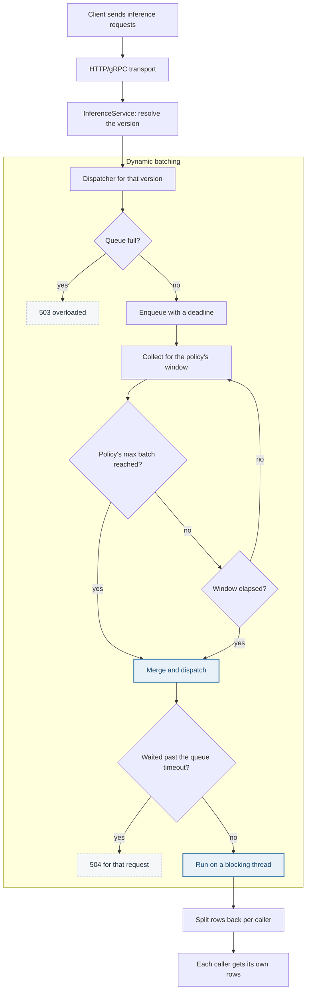
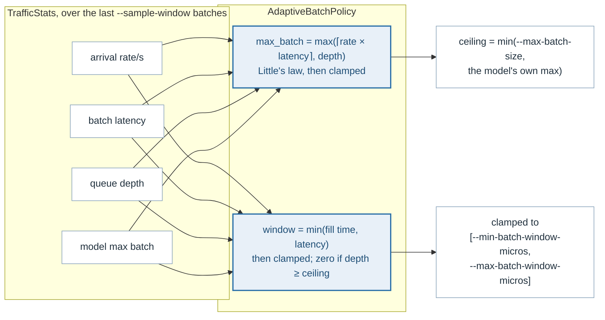

# Batching

Most models answer a batch of rows in little more time than a single row, so
grouping requests raises throughput sharply. Batching on the server keeps that
benefit without asking clients to coordinate, and it is the server that can
see the whole arrival pattern.

One `Dispatcher` owns one model version. Requests arrive on a bounded queue;
the dispatcher collects them until the policy's size or window is reached,
runs them as a single call, and returns each caller its own rows.

## The scheduler

The dispatcher forms the next batch *while* the current one executes rather
than afterwards, so the backend is not idle during collection.

## The adaptive policy

`BatchPolicy` decides two numbers from what the dispatcher has recently seen —
arrival rate, batch latency, mean rows per batch, queue depth and the model's
own maximum batch size:

**Size follows Little's law.** The number of requests expected to arrive while
one batch executes is the arrival rate times the batch latency, so that is the
batch size which keeps the backend busy without making anyone wait for a batch
that will not fill.

**The window never exceeds the time a batch takes.** It is the time the rest
of a full batch needs to turn up at the current arrival rate, capped by how
long a batch takes to execute: waiting longer than that adds latency to the
request already in hand without raising throughput, because the backend would
have been free again by then. When there are already as many requests queued
as the ceiling allows, the window is zero — requests already waiting need no
waiting for.

Quiet traffic therefore yields batches of one or two and near-minimum windows;
heavy traffic grows both up to their ceilings. `FixedBatchPolicy` pins both
numbers, for benchmarks and tests that need a predictable batch.

| Flag | Default | |
|---|---|---|
| `--max-batch-size` | 10 | Ceiling on batch size, whatever the model would allow |
| `--min-batch-window-micros` | 200 | How long a lone request may be delayed in the hope of company |
| `--max-batch-window-micros` | 5000 | Caps the latency batching can add |
| `--queue-capacity` | 1024 | Requests that may wait at once, per model |
| `--queue-timeout-secs` | 10 | Beyond this a waiting request is failed rather than run |

## Why the queue is bounded, and why it rejects

The structure this replaces was a ring buffer that overwrote the oldest
pending request once full — see [circular-buffer.md](circular-buffer.md).
Overwriting silently drops work that a client is still waiting for, which
turns saturation into a hang. A full queue here is `InferError::Overloaded`,
reported as 503, so the caller learns the server is saturated and can retry or
shed load.

The queue timeout covers the other end of the same problem: a request that has
waited longer than anyone is plausibly still waiting for should not be given a
core. It fails with 504, counted apart from a rejection in the metrics.

## Why `--max-concurrent-batches` defaults to one

Note first what it is not: the dispatcher pipelines regardless, because it
forms the next batch while the current one runs. This flag governs how many
batches of the same model may be *running*.

More than one execution of the same model cannot actually proceed in parallel,
because ONNX Runtime's `Run` is not thread-safe — `ort` makes `Session::run`
take `&mut self` for exactly that reason — so a session sits behind a mutex
and the second execution waits on it. Raising the flag therefore buys nothing
and costs something: the waiting happens on a blocking thread, which is a
thread another model could have been using. Measured on a small CNN, raising
it to four cost about a fifth of the throughput.

What does make one model use several cores is `--intra-op-threads`, which
parallelises *inside* one execution: on a 256×256 generator, one thread gave
200 requests a second over 1.2 cores and eight gave 354 over 3.3. See
[concurrency.md](concurrency.md).

The setting stays because the serialisation is the backend's and not the
dispatcher's: a backend that can run concurrently — a session pool, or a
runtime whose calls are thread-safe — makes this the knob that uses it, and
the executions are already spawned to allow for it.

## Described by

`src/batching/src/dispatcher.rs`, `src/batching/src/policy.rs`,
`src/batching/src/merge.rs`, `src/batching/src/samples.rs`.
