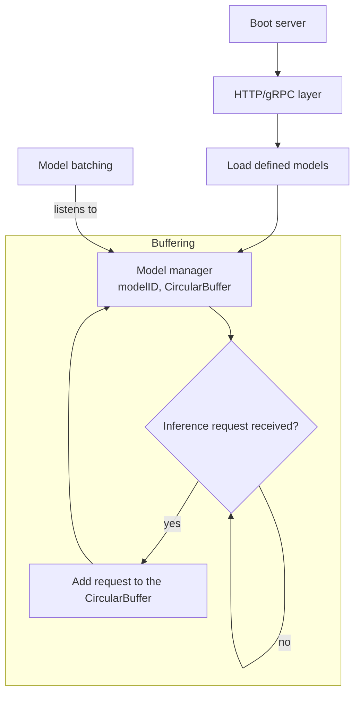
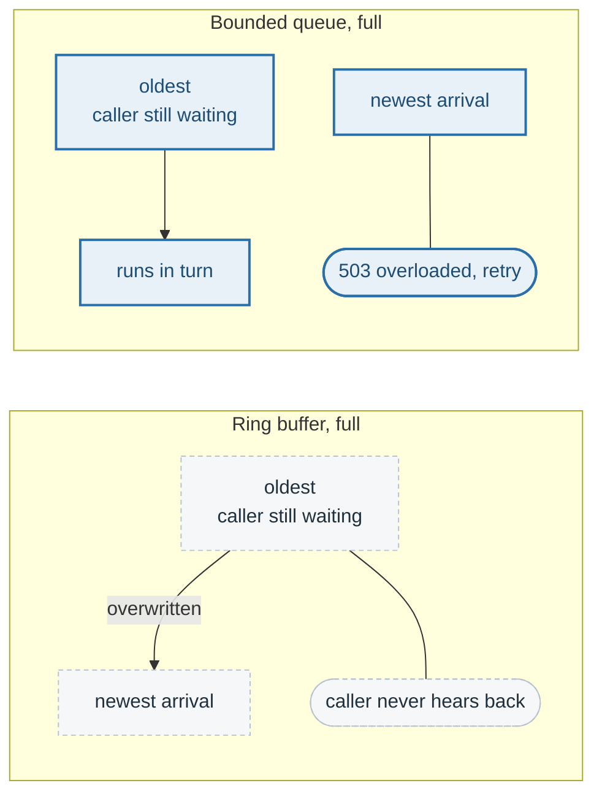

# Circular buffer — superseded

> **Status: superseded** by the bounded queue described in
> [batching.md](batching.md). Kept because the reason it was replaced is the
> reason the queue is bounded and rejecting.
>
> **The problem.** Bound the inference requests waiting for one model, so that
> a burst of callers could not grow the server's memory without limit.
>
> **How it was solved — and why that was wrong.** A fixed-size ring buffer per
> model, filled by the transport layer and drained by the batching stage. It
> bounded memory by *overwriting* the oldest entry once full, which for pending
> requests means dropping work a caller is still waiting for. The replacement
> is a bounded queue that rejects instead; see [batching.md](batching.md).

## What was designed

Each model was to own a circular buffer of pending inference requests, filled
by the transport layer and drained by the batching stage.

## Why it was replaced

A ring buffer is bounded by overwriting: once full, the oldest entry goes to
make room for the newest. That is the right structure for samples, logs and
metrics, where the newest reading is the one that matters and an old one is
worth losing.

It is the wrong structure for requests. The oldest pending entry is a caller
still holding a connection open and still waiting for an answer. Overwriting
it drops work nobody was told about: the request neither succeeds nor fails,
it simply stops existing, and the caller waits out its own timeout with no
idea why. Saturation turns into a hang, and the server's own metrics show
nothing wrong.

## What replaced it

A bounded `tokio::sync::mpsc` queue per model version, inside the dispatcher:

- **Full means refused, not overwritten.** `InferError::Overloaded`, reported
  as HTTP 503 and gRPC `RESOURCE_EXHAUSTED`, so the caller learns the server
  is saturated and can retry or shed load.
- **Waiting too long means failed, not run.** A request past
  `--queue-timeout-secs` is failed with 504 rather than given a core, because
  nobody is plausibly still waiting for it.
- **Every outcome is counted.** `rejected` and `timeout` are separate failure
  labels in the metrics, so saturation is visible on a dashboard rather than
  inferred from latency.

The ring-buffer idea did survive, in the one place it fits: `RecentSamples`,
which holds the rolling arrival-interval and batch-latency samples the
adaptive policy averages over. There, overwriting the oldest reading is
exactly the wanted behaviour.

## Described by

`src/batching/src/dispatcher.rs`, `src/batching/src/samples.rs`.
