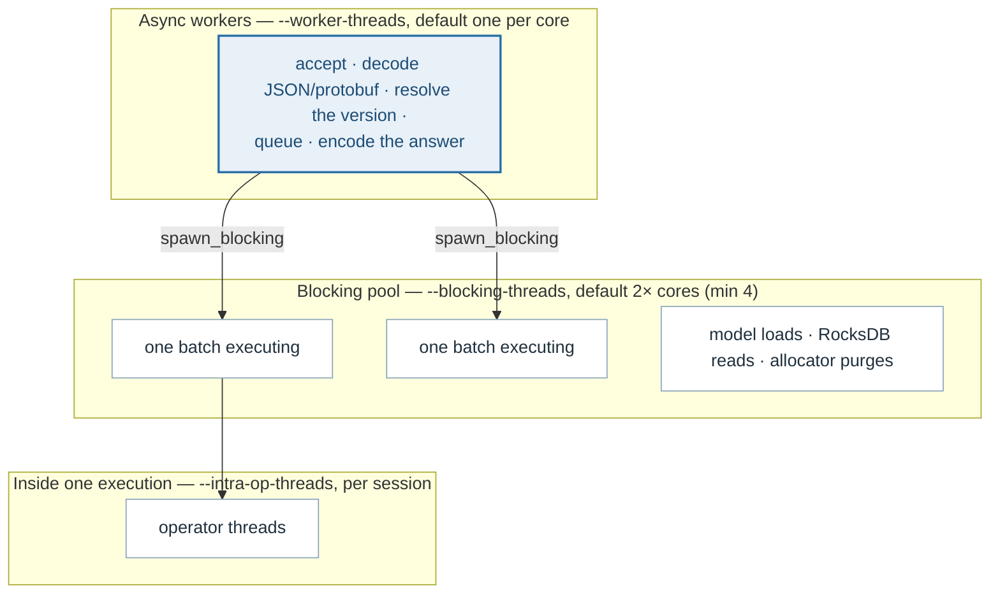
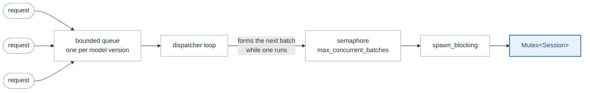

# Concurrency

> **The problem.** There are two thread pools, and a third inside the runtime
> per loaded model, and they multiply. The obvious setting for each — one
> thread per core — gives ten models ten pools of twelve on a twelve-core
> machine: 120 threads contending for 12 cores, which costs more than it buys.
>
> **How it is solved.** Every pool is bounded by this server rather than by its
> framework's default, and operator threads are divided between the models that
> can be loaded at once instead of being granted per session. The resulting
> product is published as a metric, so oversubscription is visible rather than
> inferred.

There are two thread pools and they multiply. That sentence is the whole
subject: every default here exists because the product of the two is what the
machine actually has to run, and the obvious settings produce a number far
larger than the core count.



Model code never runs on an async worker. A batch is handed to the blocking
pool, and ONNX Runtime may use `intra_op_threads` more inside a single
operator. So the ceiling on threads running model code is

```text
executions in flight × intra_op_threads
```

and comparing that with the core count is what says whether the machine is
oversubscribed. It is published as `gm_server_compute_threads_max`
([observability.md](observability.md)) so that the comparison does not need a
calculator.

## The flags

| Flag | Default | What it bounds |
|---|---|---|
| `--worker-threads` | 0 → one per core | Requests being decoded, queued and answered |
| `--blocking-threads` | 0 → 2× cores, floor of 4 | Batches that may execute at once, plus loads and store reads |
| `--intra-op-threads` | derived; see below | Threads inside one operator, **per session** |
| `--parallel-execution` | off | Independent branches of a graph at once; adds a second ORT pool per model |
| `--inter-op-threads` | 0 → ORT chooses | Only with `--parallel-execution` |
| `--max-concurrent-batches` | 1 | Batches of *one* model executing at once; see [batching.md](batching.md) |

Zero means "derive from the machine" rather than "none", so the defaults scale
with the box instead of pinning a figure chosen on someone else's. The
blocking pool keeps a floor of four and a hard minimum of one: a pool of zero
threads cannot run an inference, so an explicit zero has to mean the default.

Tokio's own default for the blocking pool is 512. On a twelve-core machine
that would let a burst across many models start 512 inferences at once, which
is why the number is ours and not the framework's.

## Why operator threads are divided, not multiplied

ONNX Runtime's threads belong to a session. Eight threads is eight threads
with one model loaded and eighty with ten. Left to choose for itself ORT takes
one thread per core *per session*: ten models on a twelve-core machine is ten
pools of twelve — 120 threads fighting over 12 cores, which costs more in
contention than it gains in parallelism.

So when `--intra-op-threads` is unset it is derived by dividing the machine
between the models that can be loaded at once — the smaller of the cache
capacity and what the repository holds:

```text
intra_op = clamp(cores / loadable_models, 1, cores / 2)
```

with two floors and a ceiling, each for its own reason:

- **at least one**, since a session needs a thread to run on;
- **at most half the machine**, so a single model cannot take a box whose
  other half is serving requests, decoding JSON and answering scrapes — which
  is where a quarter to a third of this server's CPU time goes under load;
- **rounding down**, because an operator thread that has to share a core with
  another session's costs more in contention than it returns.

On a twelve-core machine that is six threads for a single model, three for
four models and one for ten; on a two-core machine it is one whatever is
loaded. Both ends were measured, and both matter:

| Shape | Threads | Throughput |
|---|---|---|
| One model, 256×256 generator | 1 | 200 req/s over 1.2 cores |
| One model, 256×256 generator | 8 | 354 req/s over 3.3 cores |
| Six models at once | 1 | 26 337 req/s |
| Six models at once | 6 | 24 045 req/s |

An explicit value always wins, including `0`, which keeps its ORT meaning of
"let the runtime choose" rather than being read as unset. A model's own
`config.json` may raise it for itself, which is how one heavy model gets more
without the rest of the repository taking it too.

## Where the serialisation actually is



Four bounds in a row, each doing something different:

1. **The queue** bounds work waiting per model, and rejects rather than
   overwriting ([batching.md](batching.md)).
2. **The semaphore** bounds executions of one model. It is taken *after* the
   batch is formed and moved into the spawned task, which is what pipelines
   the two halves: while a batch executes, the loop is already back on the
   channel running the next batch's window, so the window is paid in parallel
   with an execution rather than after it.
3. **The blocking pool** bounds executions across all models.
4. **The session mutex** serialises one model's executions regardless, because
   `Session::run` is not thread-safe ([backends.md](backends.md)).

Because of (4), the executions in flight are bounded by the loadable model
count as well as by the pool — ten loaded models cannot have eleven executions
between them however many blocking threads exist. Reporting the pool alone
once claimed 144 threads for a server with one model and six operator threads
that could use six, which is why `compute_threads` counts executions rather
than threads.

## The locks, and what may be held across an await

| Lock | Kind | Held across an await? |
|---|---|---|
| `Mutex<Session>` | `std` | No — taken on a blocking thread, released in the same call |
| `TrafficMeter` | `std` | No — nothing awaits while recording a batch average |
| Dispatcher map | `tokio::RwLock` | No — the `Arc` is cloned out and the guard dropped before it is used |
| Metrics counters | atomics | N/A |
| Memory guard's `last` | `std` | No |

The rule the table encodes: a `std` mutex is used wherever the critical
section cannot await, and an async one only where *acquiring* it should not
block a worker. Nothing here holds a lock across an await. The dispatcher map
is the one that could be tempted to: it reads under a shared lock, and on a
miss takes the write lock and re-checks, because another task may have started
the same dispatcher while this one waited — the same double-check the model
cache's single-flight gate makes ([model-cache.md](model-cache.md)).

A poisoned `std`
lock is recovered from with `into_inner` rather than unwrapped in the places
where the worst case is a skewed average or a missed reclaim — a panic while
recording a metric is not a reason to stop serving.

## The accept queue

A listening socket has a queue of connections the kernel has completed the
handshake for and the process has not accepted yet. Full, the kernel drops
further attempts silently as far as the server is concerned, while the client
sees a connection that never completes.

`tokio::net::TcpListener::bind` asks for 1024, which is ample for clients
arriving steadily and not ample for ten thousand arriving at once. Measured
here: ten processes opening a thousand connections each cost 139 632
`ListenOverflows` and failed 97% of its requests, with the server idle at 4%
CPU. The queue was the bottleneck, and the counter that says so
(`TcpExtListenOverflows` in `nstat`) is nowhere near where anyone looks first.

So `--listen-backlog` defaults to 4096 — the common `somaxconn`, so the server
asks for what a current kernel will actually grant. The kernel caps whatever
is asked for, so a deployment expecting a storm raises both:

```text
sysctl -w net.core.somaxconn=16384
```

## The background tasks

| Task | Interval | Why it is its own task |
|---|---|---|
| Cache sweeper | `--cache-sweep-secs` | Time-to-live has to be enforced by someone when no request arrives |
| Resource sampler | `--metrics-interval-ms` | Utilisation is a rate, so it needs two readings |
| Memory guard | `--metrics-interval-ms` | A deployment may turn metrics off and still want its limit honoured; a purge is a syscall per region and does not belong on the thread answering a scrape |

All three stop on a broadcast shutdown signal, and the dispatchers drain
rather than abort: the channel closes so no new request can arrive, and what
is already running is still owed an answer.

## Described by

`src/galemind/src/cli.rs` (`ThreadArgs`), `src/galemind/src/main.rs`,
`src/service/src/runtime.rs`, `src/service/src/listener.rs`,
`src/batching/src/dispatcher.rs`, `src/onnx/src/lib.rs`.
