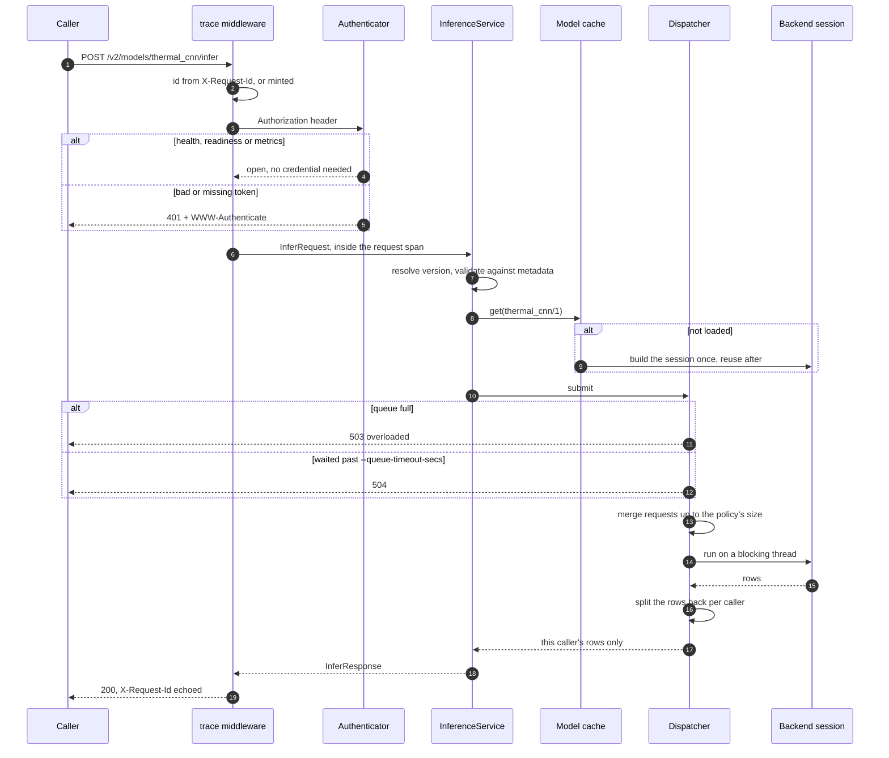
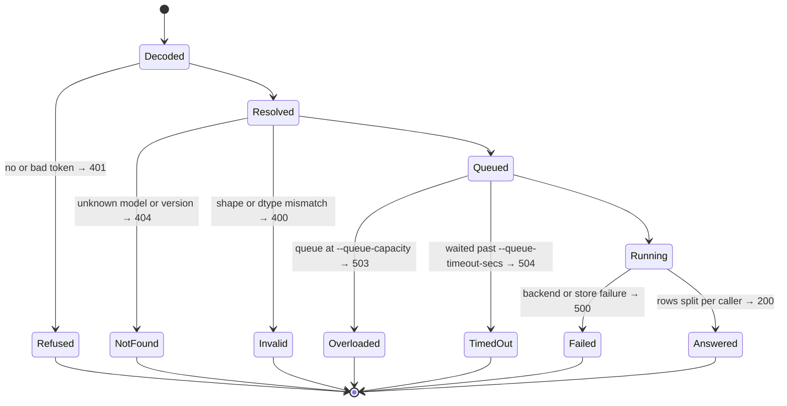

# The inference path

One request, from the socket to the answer. Each hop below is a decision that
can end the request, which is why the path is worth drawing rather than
listing.

## What each hop is for

**The id and the span.** The id is taken from `X-Request-Id` when the caller
sent one, so a trace can be followed from a gateway's log into this one, and
is echoed on the response either way, so a caller that did not send one can
still quote the id of a request that went wrong. Everything the server logs
while handling the request — version resolution, a model load, queueing, the
backend call — is nested inside that span.

Both ends of the request are logged, but at `debug`: a server answering twenty
thousand requests a second cannot write two lines each. At the default `info`
filter a healthy server says nothing per request, and `GALEMIND_LOG=debug`
turns the flow on. A server-side failure is logged at `warn` regardless.

**Resolution before loading.** A request naming no version is resolved against
the registry's snapshot, not against the store, so serving never waits for the
repository to be listed. The resolved `ModelKey` is what everything downstream
keys on: the cache, the dispatcher map and the per-model metrics.

**Validation against real metadata.** The request is checked against the
shapes and types the runtime reported when it loaded the model, not against
anything the caller supplied. A mismatch is `InvalidRequest` — 400 — before
any work is queued.

**Demultiplexing by version.** Each resolved version gets its own dispatcher,
created on first use. Models do not share a queue, so one slow model cannot
fill the queue another model's requests need.

**One caller's rows back.** Requests merged into a batch are split apart again
by row count on the way out; a caller sees only its own rows, and never learns
it was batched. The order of requests within a batch is not guaranteed.

## Where it can end early

Two of these are worth separating. `Overloaded` means the server never
started the work: retry it, perhaps elsewhere. `TimedOut` means the request
waited so long that nobody is plausibly still waiting for the answer, so
running it would spend a core on work already abandoned. Both are retryable —
`InferError::is_retryable` — and neither is the client's fault, which is why
the metrics count them apart, under the `rejected` and `timeout` failure
labels.

## Described by

`src/rest_server/src/trace.rs`, `src/rest_server/src/model.rs`,
`src/service/src/service.rs`, `src/batching/src/dispatcher.rs`,
`src/batching/src/merge.rs`.
