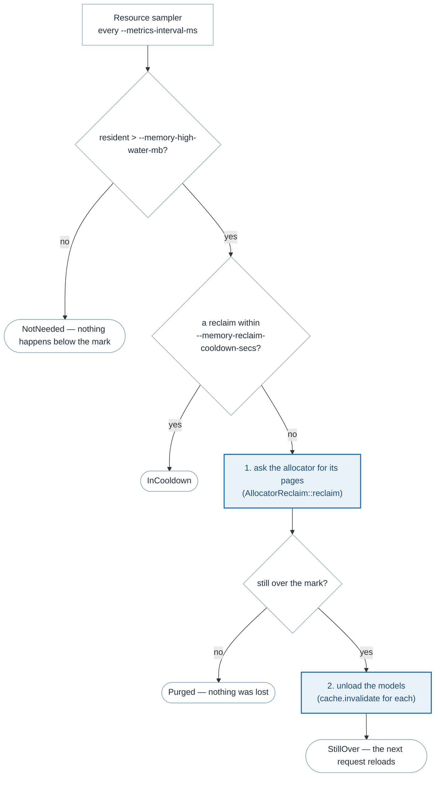
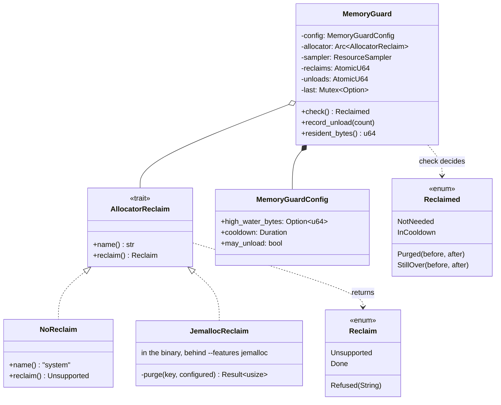
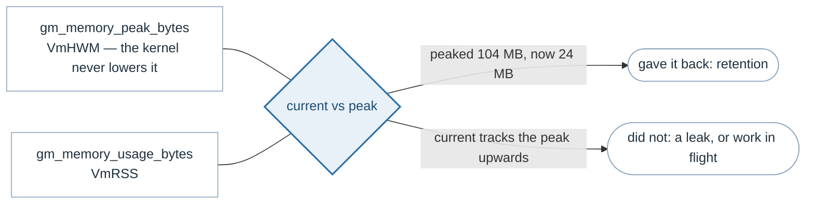

# Memory

> **The problem.** Most of this server's resident memory is held by its
> allocator and its runtime rather than by anything live. That plateaus rather
> than leaking, but a deployment with a memory limit is killed for the number,
> not for whose fault the number is.
>
> **How it is solved.** A high-water mark with a two-step reclaim: ask the
> allocator for its retained pages first, which loses nothing, and unload
> models only if that was not enough — behind a cooldown, so a server above the
> mark does not spend itself faulting the same pages back in. The peak is
> reported beside the current reading so retention can be told from a leak.

This server's resident memory is mostly not its own doing. Loaded sessions are
a few megabytes, an execution's intermediates are tens, and underneath both
the allocator keeps what it has freed rather than returning it. That is
efficient and bounded — it plateaus, it is not a leak — but a plateau is still
a number, and a deployment with a memory limit cares about the number rather
than about whose fault it is.

So there is a high-water mark, and above it the server reclaims.



Two steps, cheapest first, because they cost very different things:

1. **Ask the allocator for its pages back.** Nothing is lost — these are pages
   already freed, which the allocator was holding in case they were wanted
   again. The cost is page faults when the work returns, which is why it is
   not done after every request.
2. **Unload the models**, only if that was not enough. This does lose
   something: the next request for each model pays its load again, tens of
   milliseconds for a heavy one.

What the guard deliberately does not do is refuse requests. A server over its
memory mark is not a server that cannot answer, and the mechanism for too much
work in flight is already the queue ([batching.md](batching.md)).

## The settings

| Flag | Default | |
|---|---|---|
| `--memory-high-water-mb` | 500 | Resident megabytes above which the server reclaims. 0 turns it off. |
| `--memory-reclaim-cooldown-secs` | 30 | Minimum gap between reclaims. |

It is a limit to respect, not a target to sit at: nothing happens below it,
and returning pages is not free because the next allocation faults them back
in. The cooldown is what stops a server whose steady state is above the mark
from purging on every sample and spending itself faulting the same pages
straight back in.

## Why the allocator is a seam

Returning pages is the allocator's business, and only whoever installed the
`#[global_allocator]` knows what it installed — which is the binary, not a
library crate. So `AllocatorReclaim` is a trait in the service crate with its
implementation in `main.rs`.

| Allocator | `reclaim()` | Behaviour when idle |
|---|---|---|
| glibc (default build) | `Unsupported` | Keeps what it freed in per-thread arenas; no way to return it short of `malloc_trim`, which needs FFI |
| jemalloc (`--features jemalloc`) | `Done` | Returns unused pages on a decay timer |

Measured on this repository, after driving all ten models and then standing
idle: **glibc held 118 MB indefinitely**, and **jemalloc with a 60-second
decay fell from 214 MB to 87 MB** with every model still loaded. An operator
looking at a memory graph needs to know which of those two they are looking
at, so it is reported as `gm_server_allocator`.

The three outcomes are a deliberate alternative to a boolean, because they
call for different things to be said:

| `Reclaim` | Means | Said as |
|---|---|---|
| `Unsupported` | This build has no way to ask | A warning naming the fix: build with the jemalloc feature |
| `Done` | The allocator was asked and did what it could | Nothing, unless it was not enough |
| `Refused(reason)` | The allocator can, and this time would not | A warning with the reason; usually transient |

An earlier version inferred the allocator's name from a feature of the service
crate, and reported `system` for a binary demonstrably running jemalloc:
enabling a feature on a binary does not enable the same-named feature on its
dependencies. Hence `SYSTEM_ALLOCATOR` as the honest default and an override
from the one place that knows.

## The types



`check()` returns a **decision**, not an outcome, and that is the shape that
matters: unloading models is async and the check is not, so the guard says
what is needed and the caller does it. It also keeps the guard from logging a
count it would have to guess at.

## How jemalloc is asked

jemalloc hands pages back once they have gone unused for `dirty_decay_ms`,
which is right for a server that is merely idle and too slow for one that is
over a limit now. So a reclaim writes a decay of zero to purge what is
eligible immediately, then puts the configured interval back — it borrows the
aggressive setting rather than switching to it. Leaving a decay of zero in
place would purge after every free, which is the opposite of what the
allocator was chosen for.

Both kinds of page have to be asked for: `dirty` pages are freed but still
mapped, `muzzy` ones have been madvised away without being unmapped, and
returning one while keeping the other halves the effect. The all-arenas index
(`arena.4096.*`) is tried first and the real arenas one by one if it refuses,
which it does under load; a partial purge is still a purge, so what is
reported is how many arenas accepted rather than a failure on the first that
did not.

All of it goes through the typed `mallctl` API, so the crate keeps
`forbid(unsafe_code)`: the FFI is inside jemalloc's own crate, as it is for
the allocator itself.

Two things cannot be set from inside the process, because they are read before
`main` runs:

```text
MALLOC_ARENA_MAX=2
_RJEM_MALLOC_CONF=dirty_decay_ms:60000,muzzy_decay_ms:60000
```

`MALLOC_ARENA_MAX` is the single largest influence on this server's resident
memory under glibc. Left unset, glibc allows up to eight arenas per core — 96
on a twelve-core machine — and each keeps what it has freed. Inference frees in
large blocks from many threads, so that retention is most of the difference
between a server that settles at 70 MB and one that settles at 200 MB. It is
reported as `gm_malloc_arena_max` for exactly that reason.

jemalloc's background thread is turned on in `main`, though, because
something has to notice that a page's decay has elapsed. Without the thread
that only happens when the next allocation walks past it — and an idle server
makes no allocations, which is precisely when its memory should be going back.

## Telling retention from a leak



This is why the peak is reported alongside the current reading rather than
left to a dashboard's `max_over_time`. The kernel never lowers `VmHWM`, so the
pair is a statement about the whole life of the process, not about the scrape
window.

The guard's own logs make the same distinction one level down. A purge that
returned **nothing** and stayed over the mark means the memory is in use
rather than retained, and no amount of reclaiming will help — the batch is too
large or the mark is too low. One that returned **something** and stayed over
means the server is simply working above its limit. Those are different
operator actions, so they are different log lines.

## What else bounds memory

The guard is the backstop. Three settings decide whether it is ever reached:

| Setting | Effect on resident memory |
|---|---|
| `--max-batch-size` (default 10) | The size of an execution is what sets the plateau: one model's intermediates at a batch of ten were the difference between 180 MB and 254 MB, measured |
| `--cpu-mem-arena` (default off) | On, resident memory settles at the high-water mark of the largest batch each loaded model has ever seen, per session ([backends.md](backends.md)) |
| `--cache-capacity` (default 8) | How many sessions are resident at once ([model-cache.md](model-cache.md)) |

A server that is reclaiming often should usually change one of those rather
than raise the mark.

## Why the guard is its own task

It runs on its own interval rather than inside the metrics sampler, for two
reasons: a deployment may turn metrics off with `--allow-metrics false` and
still want its memory limit honoured, and a purge is a blocking syscall per
region, which does not belong on the thread that answers a scrape.

The check itself is synchronous and runs on the blocking pool; unloading is
async. So the guard *decides* and the task *acts* — `check()` returns
`StillOver` and the task calls `unload_all().await` and reports back with
`record_unload`. That split is also what keeps the guard from logging a count
it would have to guess.

## Described by

`src/service/src/memory.rs`, `src/service/src/resources.rs`,
`src/galemind/src/main.rs` (`JemallocReclaim`, `guard_memory`),
`src/service/src/runtime.rs`, `src/galemind/src/cli.rs` (`MetricsArgs`).
