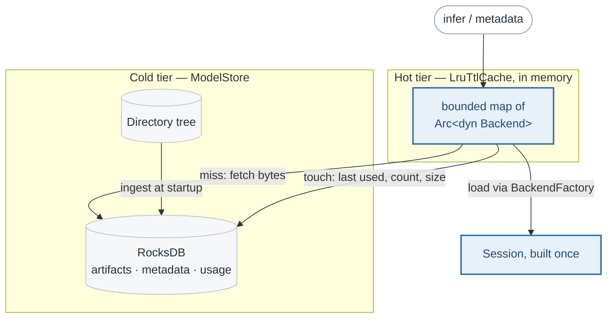
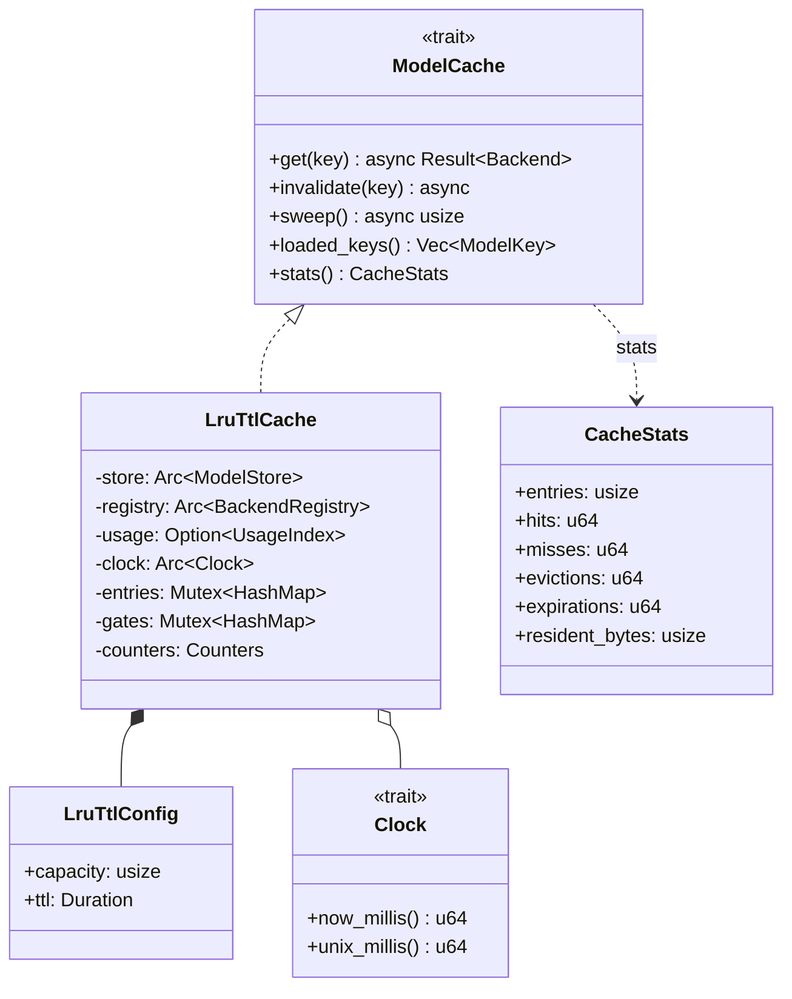
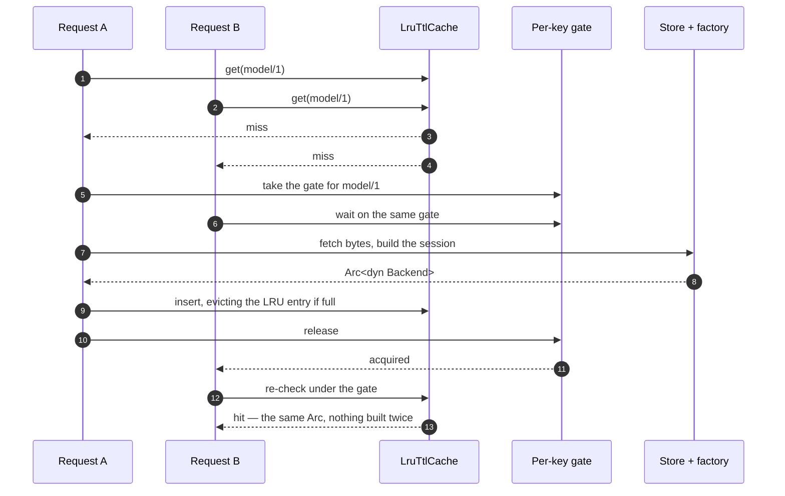
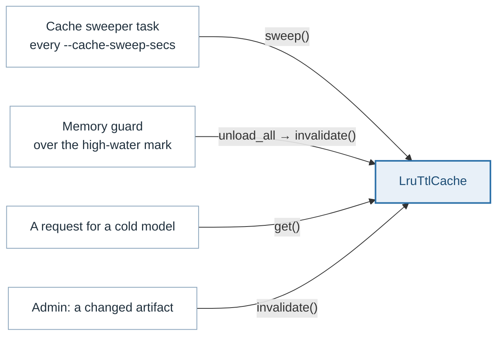

# The model cache

> **The problem.** A loaded model is a live session that cannot be serialized
> and costs tens of milliseconds to build, so it has to be reused across
> requests. Keeping every model loaded is unbounded memory; and two requests
> for the same cold model would each build it, at twice the memory while both
> are in flight.
>
> **How it is solved.** A bounded, time-to-live cache of `Arc<dyn Backend>`
> with a per-key gate, so concurrent misses load once, and a re-check after the
> gate so the waiter does not reload what it just waited for. `loaded_keys`
> sits beside `get` so that reporting what is loaded never loads anything.

A loaded model is a live runtime session: a parsed, optimized graph with its
weights allocated. It cannot be serialized, so the cache that matters at
request time is in memory. That makes the repository a two-tier affair.

## The types

`gates` is the single-flight machinery below, kept in its own map rather than
inside the entries: a gate has to exist for a key that is *not* in the cache
yet, which is precisely the case it guards. And `Clock` is injected rather
than read from the system, so the time-to-live can be tested without sleeping.

## How it is bounded

Two bounds, for two different problems:

| Bound | Flag | Default | Problem it solves |
|---|---|---|---|
| Capacity | `--cache-capacity` | 8 | Too many models loaded at once; the least recently used is dropped to make room |
| Time-to-live | `--cache-ttl-secs` | 3600 | A model nobody is asking for any more, holding memory |
| Sweep interval | `--cache-sweep-secs` | 60 | How often the time-to-live is actually enforced |

Eviction and expiration are counted separately in `CacheStats`, because they
mean different things about a deployment: evictions say the capacity is too
small for the working set, expirations say models are going quiet.

## Single-flight loading

Two requests for the same cold model must not each build a session. Building
one parses and optimizes the graph and allocates its weights — tens of
milliseconds for a heavy model, and twice the memory while both are in flight.

The re-check after acquiring the gate is the whole trick: without it, the
second waiter would load the model it just waited for someone else to load.

## Listing must not load

`ModelCache::loaded_keys` exists alongside `get` for one reason. Reporting
whether a model is loaded must not load it — otherwise listing a repository
larger than the cache would evict the models that requests are actively using,
and a dashboard refresh would be a load-test.

The same reasoning runs up through `Inference::catalogue`, which loads
nothing, and `Inference::model_info`, where loading is an explicit opt-in
because a signature can only be reported by a loaded model.

## Surviving a restart

An in-memory cache starts cold, and starting cold is unavoidable. Starting
*blind* is not: the optional `UsageIndex` — implemented by RocksDB's `usage`
column family — records last-used time, load count and resident size for every
model, so a restarted server knows which models were hot and can order its
evictions sensibly rather than by accident of arrival.

## Who drives it

The memory guard's `unload_all` is not an eviction policy — the capacity and
the time-to-live are that — but the last thing a server over a memory limit
can give up. It leaves the dispatchers running: they are cheap, and a reloaded
model finds its queue where it left it. See [memory.md](memory.md).

## Described by

`src/cache/src/lru.rs`, `src/cache/src/lib.rs`,
`src/core/src/traits.rs` (`ModelCache`, `UsageIndex`, `CacheStats`),
`src/service/src/service.rs`.
