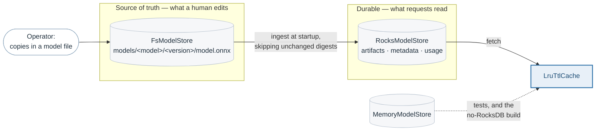
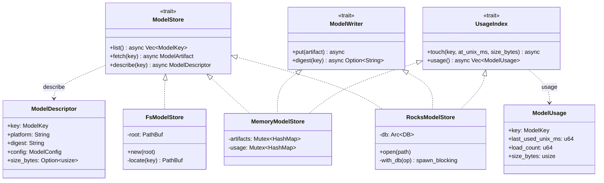
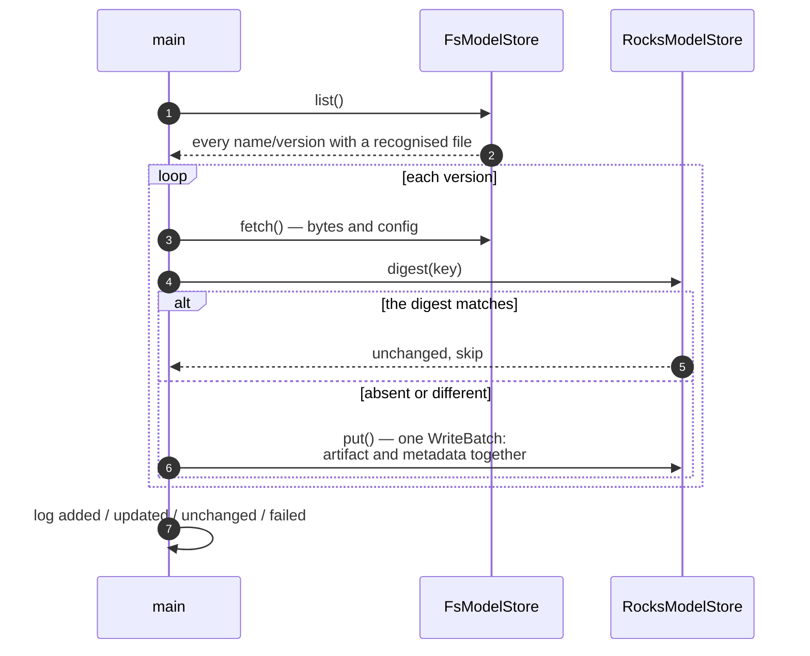

# The model store

> **The problem.** Model bytes have to live somewhere an operator can edit and
> somewhere a request can read quickly, and those are not the same place.
> Listing a repository must also not cost reading every model in it.
>
> **How it is solved.** Two stores behind one trait — a directory tree as the
> source of truth, RocksDB as the durable tier — with a digest-skipping ingest
> between them at startup. `describe` is split from `fetch` so that metadata is
> read without the bytes.

The cold tier of the two-tier repository described in
[model-cache.md](model-cache.md). A store answers two questions — which model
versions exist, and what are the bytes of one of them — and nothing else. It
does not know what a session is, because a session is the hot tier's problem.

Three implementations sit behind `ModelStore`, and the server normally runs
two of them at once: a directory tree, which is what an operator edits, and
RocksDB, which is what requests are served from.



## The traits

Three traits rather than one, because a store need not implement all three. A
read-only mirror implements `ModelStore` alone; only a target of an ingest
needs `ModelWriter`; and `UsageIndex` is the server writing about itself
rather than about models.



`ModelDescriptor` is what makes `describe` worth having: everything about a
version *except* its bytes. Note `size_bytes` is optional — a store that
cannot say cheaply says nothing rather than reading the artifact to find out.

## The repository on disk

```text
models/
  building_energy/
    config.json          optional
    1/model.onnx
    2/model.onnx
```

A version directory's name *is* the version, so versions are whatever the
operator calls them rather than integers the server assigns. A model directory
holding the model file directly, with no version directory beneath it, is
served as version `"1"` — the single-version case is the common one and should
not need a directory named `1` to express it.

The file name is what picks the runtime:

| File | Platform |
|---|---|
| `model.onnx` | `onnx_onnxv1` |
| `model.plan` | `tensorrt_plan` |
| `model.graphdef` | `tensorflow_graphdef` |
| `model.savedmodel` | `tensorflow_savedmodel` |
| `model.pt` | `pytorch_torchscript` |
| `model.netdef` | `caffe2_netdef` |

Only the first has a backend behind it today; the rest are the protocol's
platform strings, listed in the order candidates are tried. Serving a new
runtime means adding a row to `PLATFORMS` and registering a factory — see
[backends.md](backends.md) — and nothing in the store changes.

`config.json` sits beside the versions rather than inside one, because it
describes the model and not a build of it. Every field is optional and unknown
fields are ignored, so the same file can carry feature names and class labels
for a human without the server caring:

| Field | |
|---|---|
| `platform` | Overrides the platform inferred from the file name |
| `max_batch_size` | The largest batch this model will accept; see [batching.md](batching.md) |
| `intra_op_threads` | Operator threads for this model alone; see [concurrency.md](concurrency.md) |

A `max_batch_size` of zero is rejected at read time rather than clamped: it is
a configuration mistake with no sensible reading, and a model that silently
served batches of one would be a worse answer than a refusal.

## The three column families

```text
artifacts   name/version  →  the model file's bytes
metadata    name/version  →  platform, digest, config, size
usage       name/version  →  last used, load count, resident size
```

Splitting metadata from artifacts is what makes listing cheap. `describe`
reads only the `metadata` family, so describing every version of every model
costs no artifact reads at all; `fetch`, which is the one that returns bytes,
is called only on a cache miss. The default `describe` on the trait falls back
to `fetch` — correct, and it reads every byte of every model, which is why
both real stores override it.

The filesystem store overrides it too, by stat-ing the file instead of reading
it. Its digest is then left empty, deliberately: a digest is a hash of the
bytes, and hashing them means reading them, which is the cost the override
exists to avoid.

## The startup ingest



Digest-skipping is what keeps a restart cheap: a repository that has not
changed is not rewritten, so restarting a server with ten models is ten
hashes rather than ten writes. The artifact and its metadata go in a single
`WriteBatch`, so a crash mid-ingest cannot leave metadata pointing at bytes
that were never stored.

A model that fails to copy is logged and counted, not fatal. One unreadable
artifact must not stop the server from serving the others — the `IngestReport`
carries `failed` alongside `added`, `updated` and `unchanged` precisely so
that a partial ingest is visible rather than silent.

`galemind ingest` runs exactly this and exits, which is how a deployment
populates a volume before any server is pointed at it.

## Why usage is persisted

`UsageIndex` is a separate trait from `ModelStore` because it is a different
kind of data: artifacts are written by an operator and read by the server,
while usage is written by the server about itself. RocksDB implements both, so
in practice they share a database, but the cache depends only on the narrow
trait.

`touch` is a read-modify-write rather than a counter increment, because
`load_count` has to survive the process that incremented it. What this buys is
in [model-cache.md](model-cache.md): a restarted server knows which models
were hot, so its first evictions are ordered rather than arbitrary.

## Running without RocksDB

RocksDB needs libclang at build time, which is a real cost for someone who
only wants to try the server. So it is a default feature rather than a
requirement: `--no-default-features` drops it, and `--store filesystem` serves
model files straight from the directory tree with an in-memory usage index.

What is given up is durability of the usage records and a single home for the
bytes, not the ability to serve. Everything above the trait is unchanged,
which is the point of the trait.

## Blocking, and where it happens

Every RocksDB call goes through `with_db`, which is a `spawn_blocking`.
RocksDB's API is synchronous and its reads touch disk, so calling it from an
async worker would park a thread that has requests to decode. The async
signature on `ModelStore` is therefore not decoration: it is what lets a
store be slow without being in the way. See [concurrency.md](concurrency.md).

## Described by

`src/store/src/fs.rs`, `src/store/src/rocks.rs`,
`src/store/src/ingest.rs`, `src/store/src/config.rs`,
`src/store/src/platform.rs`, `src/store/src/memory.rs`,
`src/core/src/traits.rs` (`ModelStore`, `ModelWriter`, `UsageIndex`).
