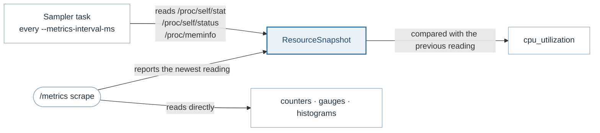
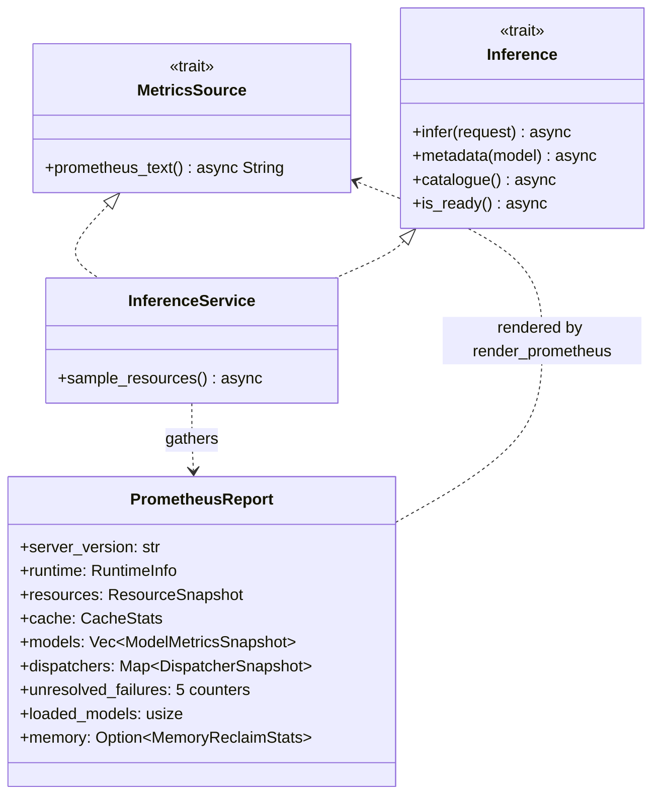
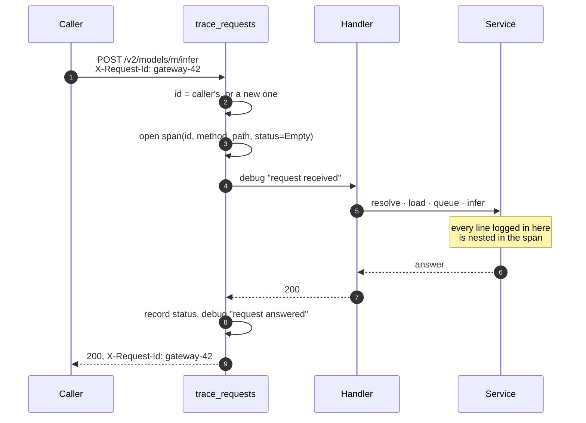

# Observability

> **The problem.** When this server is slow or large, the cause is usually a
> configuration that is invisible from outside the process — a thread plan, a
> batch size, an allocator. And an operator who already runs Triton dashboards
> should not have to rewrite them to watch this.
>
> **How it is solved.** Triton's metric names with a `gm_` prefix, and metrics
> that cannot apply left out rather than reported as zero. The thread plan, the
> allocator and the memory mark are series of their own, and one span per
> request carries an id the caller can quote.

Three things, with different lifetimes and different audiences: metrics for a
dashboard, a span per request for a log, and a thread plan reported once so
that the other two can be read at all.

## Triton's names, with one prefix changed

The metric names follow NVIDIA Triton's, with `gm_` where Triton uses `nv_`,
so existing dashboards and alerts port across with a prefix change. The
alternative — inventing names — makes every operator who has run Triton
rewrite queries they already have.

Metrics that cannot mean anything here are **left out rather than reported as
zero**: there are no GPU metrics on a CPU server, no pinned-memory metrics
without a GPU to pin for, and no response-cache metrics without a response
cache. A zero means "this was measured and it was zero", which is a different
claim from "this does not apply".

Counters are cumulative and never reset, which is what Prometheus expects:
rates are the scraper's job, computed from the difference between scrapes.

## What is reported

### Per model (`model`, `version` labels)

| Metric | Type | |
|---|---|---|
| `gm_inference_request_success` | counter | Requests answered |
| `gm_inference_request_failure` | counter | Also labelled `reason` |
| `gm_inference_count` | counter | Rows inferred — a batch of ten counts ten |
| `gm_inference_exec_count` | counter | Batches executed — the same traffic counts one |
| `gm_inference_pending_request_count` | gauge | Requests waiting in this model's queue |
| `gm_inference_request_duration_us` | counter | Total end-to-end microseconds |
| `gm_inference_queue_duration_us` | counter | Total microseconds spent waiting |
| `gm_inference_compute_infer_duration_us` | counter | Total microseconds inside the backend |
| `gm_inference_request_duration_seconds` | histogram | 12 buckets, 0.1 ms to 1 s |
| `gm_batch_merged_count` | counter | Rows merged into batches |

`gm_inference_count` against `gm_inference_exec_count` is the batching
efficiency — rows per execution — which is the number
[batching.md](batching.md) is about. The three duration counters are the
request split into its parts: queue, compute, and the whole, so a slow server
can be attributed to the stage that is slow rather than guessed at.

The histogram's buckets span a CPU model answering in well under a
millisecond up to a request that waited behind a full queue, with the most
resolution where a tree ensemble actually lands:

```text
0.1ms  0.25  0.5  1ms  2.5  5  10ms  25  50  100ms  500  1s
```

### Failure reasons

| `reason` | From | Means |
|---|---|---|
| `rejected` | `Overloaded` | The queue was full |
| `timeout` | `Timeout` | Waited past `--queue-timeout-secs` |
| `backend` | `Backend`, `Store` | The model or the runtime failed |
| `invalid` | `InvalidRequest`, `ModelNotFound`, `VersionNotFound`, `Unsupported`, `ModelNotReady` | Not a valid request for this model |
| `other` | `Internal` | Everything else |

Triton's categories are `REJECTED`, `CANCELED`, `BACKEND` and `OTHER`.
Cancellation cannot be observed here, and `invalid` is worth telling apart
from `backend` because only one of them is the client's to fix — a dashboard
that merges them cannot answer "is this us or them?".

Every reason is emitted from the first request on, even at zero, so a
dashboard has no gaps and a `rate()` over a quiet series returns 0 rather than
nothing. A request that never resolved to a model is counted with empty
`model` and `version` labels, because it has no model to be counted against.

### The model cache

| Metric | |
|---|---|
| `gm_model_cache_entries`, `gm_model_cache_resident_bytes` | What is loaded now |
| `gm_model_cache_hit_count`, `gm_model_cache_miss_count` | Whether the cache is sized right |
| `gm_model_cache_eviction_count` | The capacity is too small for the working set |
| `gm_model_cache_expiration_count` | Models are going quiet |
| `gm_models_available` | Versions the server knows about |

Evictions and expirations are separate counters because they mean different
things about a deployment; see [model-cache.md](model-cache.md).

### Process and machine

| Metric | |
|---|---|
| `gm_cpu_utilization`, `gm_cpu_count` | 1.0 is every core fully busy |
| `gm_memory_usage_bytes` | `VmRSS` |
| `gm_memory_peak_bytes` | `VmHWM` — the kernel never lowers it |
| `gm_memory_total_bytes`, `gm_memory_utilization` | Against the machine |
| `gm_memory_high_water_bytes` | The configured mark |
| `gm_memory_reclaim_count` | Reclaims run |
| `gm_memory_reclaim_unload_count` | Reclaims that went on to unload models |
| `gm_server_uptime_seconds` | |

The peak beside the current reading is what tells retained memory from leaked
memory, and the reclaim counters are reported *with their zeroes* when a mark
is configured: a dashboard needs to be able to see that the limit exists and
is not being hit. A rising `unload_count` is a server that needs more memory
or a smaller batch, not a server working as intended. See
[memory.md](memory.md).

### The thread plan, reported once

| Metric | |
|---|---|
| `gm_server_info`, `gm_server_version`, `gm_server_platform` | Build identity |
| `gm_server_allocator` | `glibc` or `jemalloc` — whether idle memory comes back |
| `gm_server_worker_threads`, `gm_server_blocking_threads` | The two pools |
| `gm_server_intra_op_threads`, `gm_server_loadable_models` | What they multiply |
| `gm_server_compute_threads_max` | The product; above `gm_cpu_count` the machine is oversubscribed |
| `gm_malloc_arena_max` | glibc's arena limit, when the environment sets it |
| `gm_server_cpu_mem_arena` | Whether ORT's arena is in use |

This is the part that is easy to leave out and shouldn't be. A server that is
slow because it was given one worker thread, or because every model opened a
thread pool per core, looks exactly like a server that is slow because the
model is slow — unless the thread plan is written down where a scrape can see
it. See [concurrency.md](concurrency.md).

`gm_server_version` and `gm_server_platform` exist alongside `gm_server_info`
because joining against a multi-label info metric works in a query and is
awkward in an alert.

## Why utilisation is sampled, not measured per scrape



CPU utilisation is a rate, so it only means anything *between* two readings. A
scrape cannot produce one on its own — it would have to sleep — so the server
samples on an interval and a scrape reports the newest reading, which is what
Triton calls a per-interval metric. Request counters are unaffected and update
per request.

Where `/proc` is unavailable the snapshot reports zeros rather than failing
the scrape. A metrics endpoint that 500s because it could not read a file is
worse than one reporting a gap.

## `MetricsSource` is not `Inference`



Both collections are keyed by `ModelKey`, and `loaded_models` is the count of
versions the registry knows about rather than the count resident in the cache
— which is what `gm_models_available` reports.

Serving metrics is not part of the Predict Protocol, so it is a separate
trait: a transport can expose it or not without the protocol implementation
knowing either way, which is exactly what `--allow-metrics false` does. One
type implements both, and that is an implementation detail rather than a
coupling.

A report is **gathered first and rendered second**. Rendering holds no locks
and takes no readings, so a scrape cannot observe a half-updated picture where
the cache stats are newer than the counters.

## One request, one span



The id is taken from `X-Request-Id` when the caller sent one, so a trace can
be followed from a gateway's log into this one, and echoed on the response
either way, so a caller that did not send one can still quote the id of a
request that went wrong. An id that could forge a header or a log line is
replaced rather than passed through.

`status` is declared empty and recorded on the way out, which is what makes
every line logged *inside* the span carry the outcome.

The volume is chosen for a server that answers twenty thousand requests a
second: arrival is `debug`, completion is `debug` for a success and `warn` for
a server error. At the default `info` filter a healthy server therefore says
nothing per request, and `GALEMIND_LOG=debug` turns the flow on. Two lines per
request at `info` would be a server that cannot be run at its own throughput.

## Described by

`src/service/src/metrics.rs`, `src/service/src/resources.rs`,
`src/service/src/runtime.rs`, `src/rest_server/src/trace.rs`,
`src/core/src/traits.rs` (`MetricsSource`), `src/galemind/src/cli.rs`
(`MetricsArgs`).
