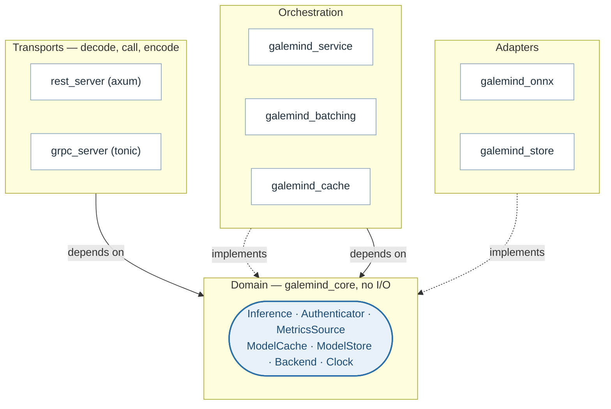
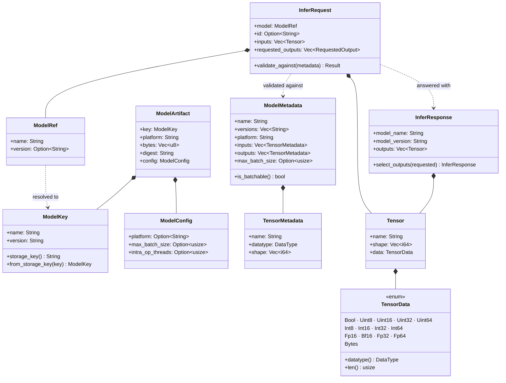
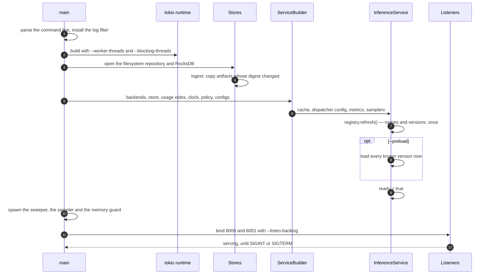

# Overview: layering and seams

> **The problem.** A server like this has to bind a wire protocol, a model
> runtime, a storage engine and a thread plan together. Done directly, each of
> those choices leaks into the others: the transport comes to know that ONNX
> Runtime exists, a unit test needs RocksDB on the machine, and nothing can be
> replaced without touching everything beside it.
>
> **How it is solved.** Every replaceable part is a trait in a crate that does
> no I/O, and every dependency arrow points inwards at those traits.
> `ServiceBuilder` is the one place implementations are injected, so production
> gets RocksDB and ONNX Runtime while a test gets a memory store and a
> controllable clock — with no change to the service between them.

GaleMind Server is a CPU inference server that speaks the [Predict Protocol
v2](https://github.com/kserve/open-inference-protocol) over HTTP and gRPC and
nothing else. It loads ONNX models from a repository, merges concurrent
requests into batches, keeps the hot models in memory, and reports what it is
doing in Prometheus text.

It is a workspace of small crates, each depending on behaviour rather than on
a runtime, a framework or a storage engine. That sentence is the whole design;
everything below is what it costs and what it buys.

## The layers

The arrows all point inwards, at traits in a crate that does no I/O. A
transport depends on `Inference`, not on a service; the cache depends on
`Backend`, not on ONNX Runtime; and every box outside the domain is
replaceable without touching the ones beside it. There is one service
implementation behind two protocols rather than two servers, which is why a
fix to version resolution cannot land on one port and not the other.

## The seams

Everything replaceable is a trait in `src/core/src/traits.rs`, implemented
elsewhere:

| Trait | Replace it to | Implemented by |
|---|---|---|
| `Backend`, `BackendFactory` | Serve a runtime that is not ONNX | `galemind_onnx` |
| `ModelStore`, `ModelWriter` | Keep models somewhere else | `FsModelStore`, `RocksModelStore`, `MemoryModelStore` |
| `UsageIndex` | Persist the eviction order differently | `RocksModelStore` |
| `ModelCache` | Change what stays loaded | `LruTtlCache` |
| `Inference` | Put something else behind both transports | `InferenceService` |
| `Authenticator` | Check credentials against a real provider | `NoAuth`, static-token auth |
| `MetricsSource` | Report somewhere other than Prometheus text | `InferenceService` |
| `Clock` | Make time deterministic in a test | `SystemClock`, test clocks |
| `AllocatorReclaim` | Give pages back from a different allocator | binary-installed, `NoReclaim` otherwise |

`ServiceBuilder` is where they meet. Every part is injected as a trait object,
so a test supplies a memory store and a controllable clock while production
supplies RocksDB and the real one, with no change to the service itself.

## The domain types

The traits above are the verbs. These are the nouns they pass around, and all
of them live in `galemind_core` with no I/O attached:

Two distinctions in there carry weight. A `ModelRef` may omit the version and
a `ModelKey` may not, so resolution is a type change rather than a convention
— once you hold a `ModelKey`, the version question is settled. And
`TensorData` is one enum over every protocol datatype rather than a byte
buffer plus a tag, so a tensor that type-checks cannot disagree with its own
datatype.

## Crates

| Crate | |
|---|---|
| `src/core` | The domain: datatypes, tensors, model identity, requests, the JSON encoding, the authentication trait, and the traits every replaceable part implements. No I/O. |
| `src/onnx` | The ONNX Runtime backend. The only crate that knows ONNX Runtime exists. |
| `src/store` | Model repositories: a directory tree, RocksDB, memory. |
| `src/cache` | The bounded, time-to-live model cache with single-flight loading. |
| `src/batching` | The per-model dispatcher and the adaptive batch policy. |
| `src/service` | Resolution, caching and batching behind one trait; metrics; the listening socket. |
| `src/rest_server` | The HTTP transport, the tracing and auth middleware. |
| `src/grpc_server` | The gRPC transport and its authentication layer. |
| `src/galemind` | The server binary and its command line. |
| `src/client/rust` | The client library, the load generator, and `gmctl`. |
| `src/client/python` | The Python client. |
| `src/e2e` | The end-to-end suite, in its own workspace. |

## From start to first request

Two things are explicit here on purpose. The registry is refreshed rather than
read per request, so serving a request never waits for the store to be listed.
And the ingest is digest-skipping, so a restart does not rewrite a repository
that has not changed.

## Why the end-to-end suite is a separate workspace

Cargo unifies features across every package selected for a build, so while
`src/e2e` was a member, `cargo test` resolved shared leaf crates differently
from `cargo build`; that moved bindgen's fingerprint, and with it the
`librocksdb-sys` build script's, recompiling 330 C++ translation units on
every alternation between the two. The cost of the split is a separate
`src/e2e/target` and dependency versions kept in step by hand.

## Described by

`src/core/src/traits.rs`, `src/core/src/lib.rs`, `src/service/src/builder.rs`,
`src/galemind/src/main.rs`, `Cargo.toml`.
