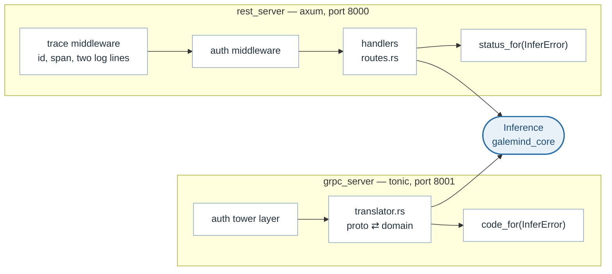
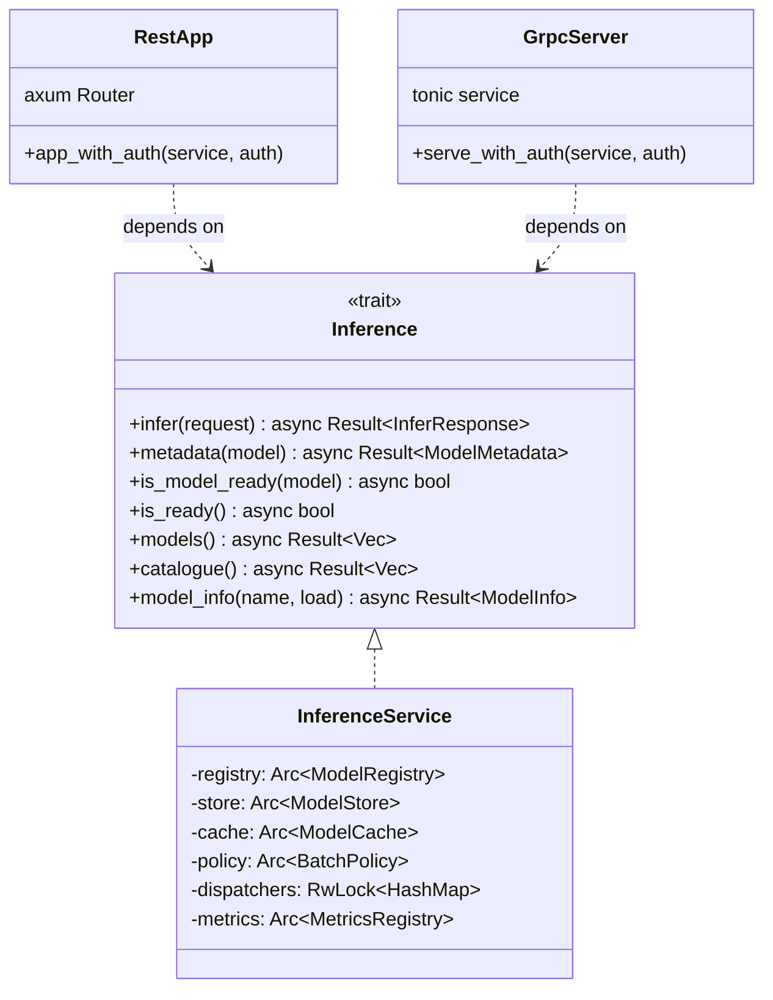

# Transports: two ports, one service

> **The problem.** The protocol has to be served over two wire formats with
> different encodings, routing and error vocabularies. Implemented as two
> servers they drift: a fix to version resolution lands on one port and not the
> other, and the two come to disagree about what a 404 means.
>
> **How it is solved.** One `Inference` implementation behind both ports. Each
> transport only decodes a request, calls the trait and encodes the answer, and
> the single `InferError` is mapped once per protocol onto an HTTP status or a
> gRPC code.

The HTTP and gRPC servers decode a request, call `Inference`, and encode the
answer. That is all they do. Neither of them knows that a cache, a dispatcher
or ONNX Runtime exists, which is why there is one service implementation
behind two protocols rather than two servers that have to be kept in step.

## The HTTP surface

The eight URLs of the Predict Protocol v2, plus two catalogue endpoints of
this server's own, plus the metrics scrape:

| Method | Path | |
|---|---|---|
| `GET` | `/v2` | Server metadata |
| `GET` | `/v2/health/live` | Liveness |
| `GET` | `/v2/health/ready` | Readiness |
| `GET` | `/v2/models/{model}` | Model metadata |
| `GET` | `/v2/models/{model}/versions/{version}` | Version metadata |
| `GET` | `/v2/models/{model}/ready` | Model readiness |
| `GET` | `/v2/models/{model}/versions/{version}/ready` | Version readiness |
| `POST` | `/v2/models/{model}/infer` | Inference |
| `POST` | `/v2/models/{model}/versions/{version}/infer` | Inference, pinned version |
| `GET` | `/v2/models/list` | Catalogue: every model, its versions, which are loaded |
| `GET` | `/v2/models/info/{model}` | Catalogue: one model's versions and signatures |
| `GET` | `/metrics` | Prometheus text |

The two catalogue endpoints exist because the protocol has no way to ask what
a server can serve, and `/metrics` because the protocol says nothing about
observability. Both are additions, not changes: a client that knows only the
protocol sees exactly the protocol.

Listing the catalogue deliberately loads nothing — see
[model-cache.md](model-cache.md#listing-must-not-load).

## The seam both ports meet at

What the diagram is saying is as much about the edges that are *absent*:
neither transport has an arrow to `InferenceService`. Each is handed an
`Arc<dyn Inference>` and cannot reach the concrete type, which is what makes
"one service behind two protocols" a compile-time fact rather than a
convention — and why a fix to version resolution cannot land on one port and
not the other.

Note that `model_info` takes a `load` flag while `catalogue` does not. Loading
a model to report its signature is an explicit opt-in, because a signature can
only come from a loaded model; see [model-cache.md](model-cache.md).

## One error, two vocabularies

`InferError` crosses every layer and neither transport invents its own. Each
maps the same variant to its own protocol's nearest equivalent, in one
function, with a test that walks the table:

| `InferError` | HTTP | gRPC |
|---|---|---|
| `ModelNotFound`, `VersionNotFound` | 404 Not Found | `NOT_FOUND` |
| `InvalidRequest` | 400 Bad Request | `INVALID_ARGUMENT` |
| `Unsupported` | 501 Not Implemented | `UNIMPLEMENTED` |
| `ModelNotReady` | 503 Service Unavailable | `FAILED_PRECONDITION` |
| `Overloaded` | 503 Service Unavailable | `RESOURCE_EXHAUSTED` |
| `Timeout` | 504 Gateway Timeout | `DEADLINE_EXCEEDED` |
| `Backend`, `Store`, `Internal` | 500 Internal Server Error | `INTERNAL` |
| `Remote { client_error }` | 400 or 502 | `INVALID_ARGUMENT` or `INTERNAL` |

`Remote` is the one variant a client produces rather than the server: a
failure another server reported, kept in that server's own words. A client
must not re-word what the server said, because the server knows what went
wrong and wrapping its sentence inside another one only produces nested
quoting. The `client_error` flag records whose fault it was, which is the part
a caller may still want to branch on.

`InferError` is `Clone` for one concrete reason: a failed batch has to be
reported to every request that was merged into it.

## Why the exemption list is not here

Which endpoints may be reached without a credential is decided in
`galemind_core::auth`, not in either transport, so the two ports cannot drift
into protecting different things. A transport contributes only the part that
is its own: parsing a header, shaping a refusal. See
[authentication.md](authentication.md).

## Described by

`src/rest_server/src/routes.rs`, `src/rest_server/src/error.rs`,
`src/grpc_server/src/translator.rs`, `src/grpc_server/src/convert.rs`,
`src/core/src/error.rs`.
