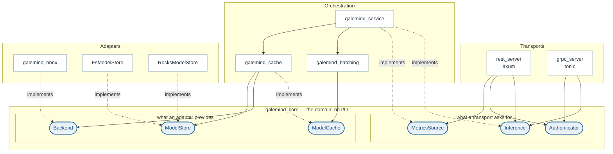
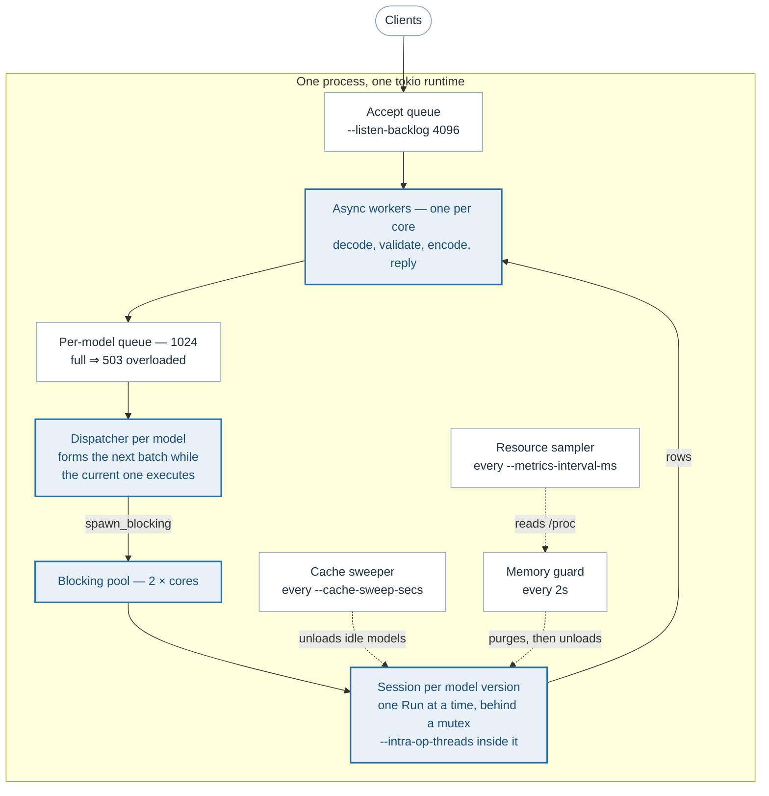
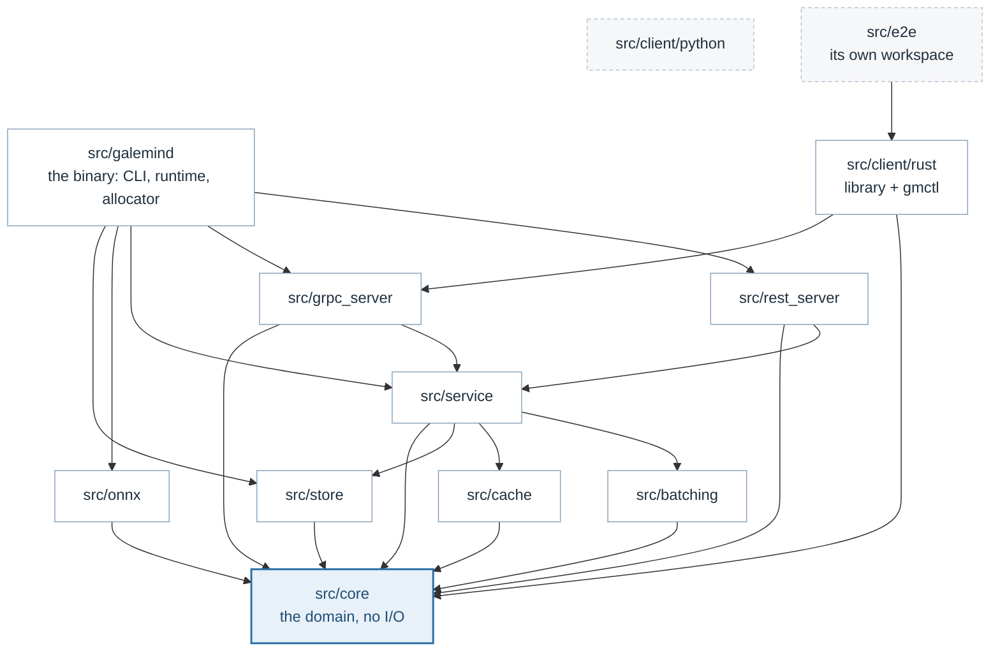
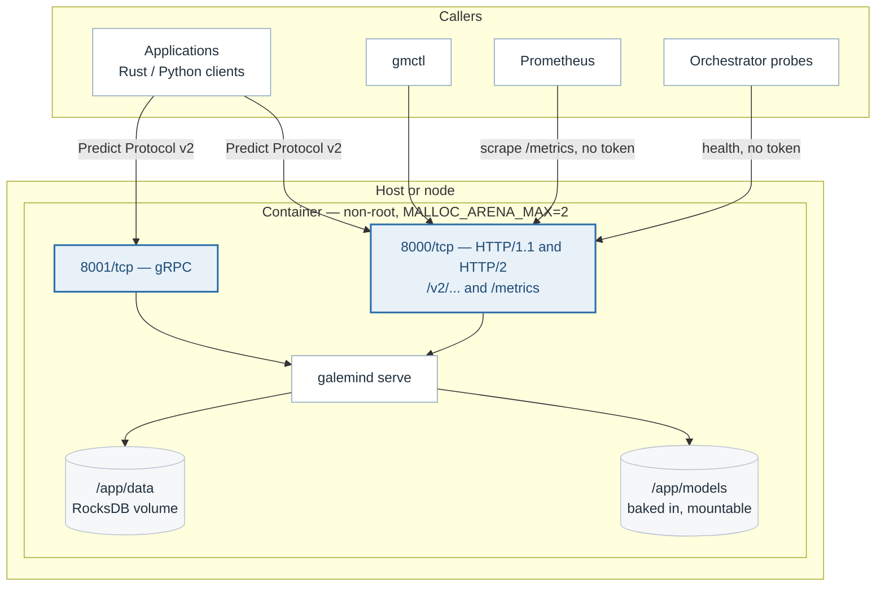
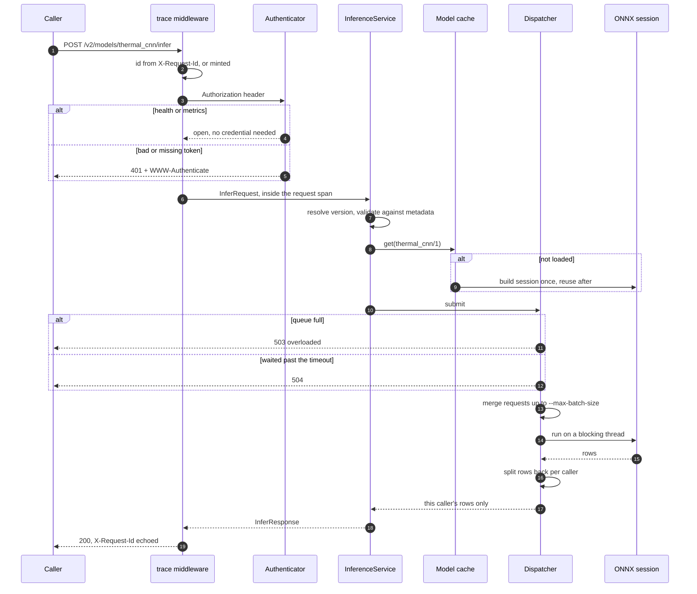
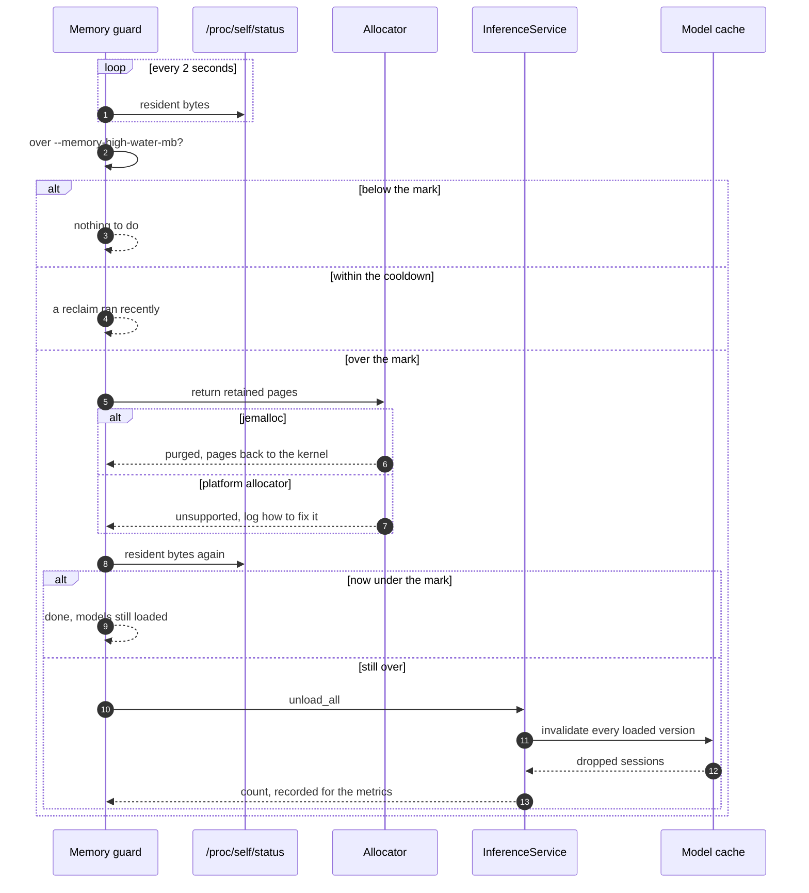

# The 4+1 views

Five diagrams, in Kruchten's arrangement: four views of the same server, and
the scenarios that tie them together. Each answers a different question, and
none of them is the architecture by itself.

| View | The question it answers |
|---|---|
| [Logical](#logical-view--what-the-pieces-are) | What are the pieces, and which abstractions do they meet at? |
| [Process](#process-view--what-runs-at-once) | What runs at once, and what bounds it? |
| [Development](#development-view--the-workspace) | Which crate may depend on which? |
| [Physical](#physical-view--where-it-runs) | Where does it run, and who talks to it? |
| [Scenarios](#scenarios--the-1) | Does the whole thing actually work, end to end? |

The same five diagrams are kept as standalone Mermaid sources in
[`website/diagrams/`](../../website/diagrams) and rendered to SVG for the
documentation site, so a change to the architecture is a change to a text file
and a re-render rather than a redrawing:

```bash
cd website
npx @mermaid-js/mermaid-cli -i diagrams/logical-view.mmd \
  -o static/img/views/logical-view.svg -b transparent
```

## Logical view — what the pieces are

The arrows all point inwards, at traits in a crate that does no I/O. That is
the whole structural claim of this server: a transport depends on `Inference`,
not on a service; the cache depends on `Backend`, not on ONNX Runtime; and
every box outside the domain is replaceable without touching the ones beside
it.



## Process view — what runs at once

The same picture in motion, and the one that explains the flags. Requests are
decoded on async workers, wait in a per-model queue, are merged by that
model's dispatcher, and execute on a blocking thread inside a session that
runs one batch at a time. Three background tasks watch the rest: the cache
sweeper, the resource sampler and the memory guard.



Details, and the measurements behind the numbers, in
[concurrency.md](concurrency.md).

## Development view — the workspace

Which crate may depend on which. `src/core` has no dependency on anything in
the workspace, which is what makes it testable without a runtime; `src/e2e`
is outside the workspace entirely, for the feature-unification reason in
[overview.md](overview.md#why-the-end-to-end-suite-is-a-separate-workspace).



## Physical view — where it runs

One container, one process, two ports. Everything an operator needs on the
HTTP port — the protocol, the catalogue, health and `/metrics` — and the
protocol again on the gRPC port. Health and metrics are reachable without a
credential by design, so probes and scrapes survive turning authentication
on; see [authentication.md](authentication.md).



## Scenarios — the +1

Two walks through the whole stack, which is what the four views are for.

### One inference

Including every way it can end early: an open endpoint, a refused credential,
a full queue, a timed-out wait.



Narrated step by step in [inference-path.md](inference-path.md).

### Resident memory crosses the mark

The memory guard touches the allocator, the cache and the metrics, and is the
clearest example of a decision split between a component that can measure and
a caller that can act.



Narrated in [memory.md](memory.md).

## Described by

[`website/diagrams/*.mmd`](../../website/diagrams),
[`website/docs/architecture.mdx`](../../website/docs/architecture.mdx).
